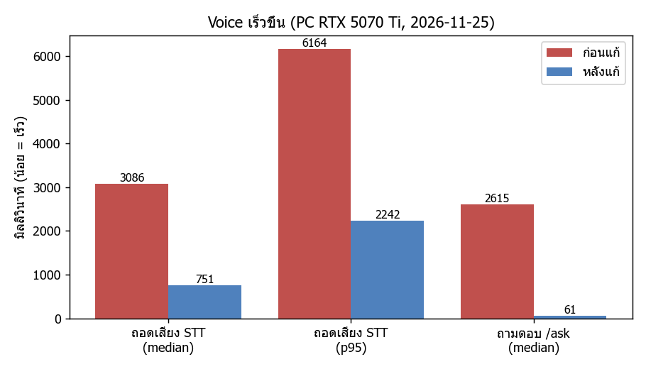
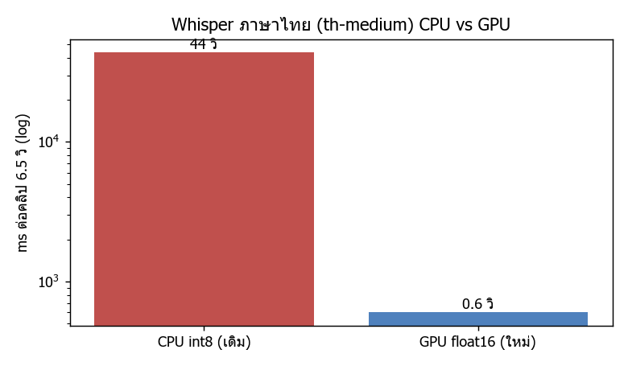
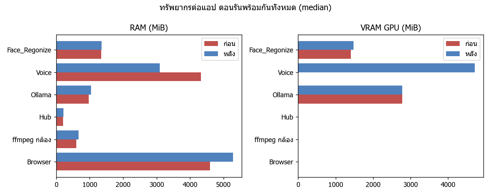
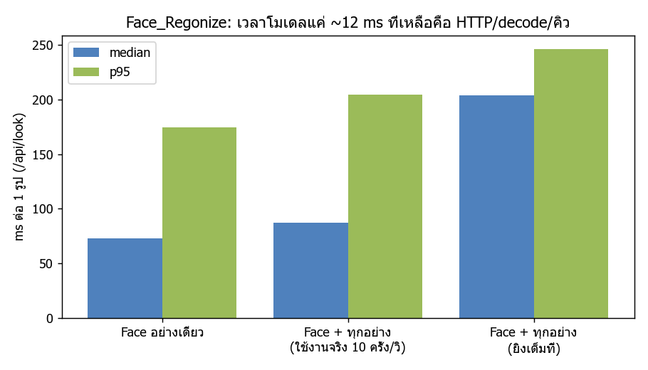

# รันทุกแอปพร้อมกัน: วัดจริง หาคอขวด แก้ (2026-11-25)

เครื่อง: PC โน้ตบุ๊ก RTX 5070 Ti Laptop 12 GB, driver 621, Windows 11
รันพร้อมกัน: hub (กล้อง USB ตัวเดียว แชร์ผ่าน MJPEG), voice helper (Whisper + Qwen สำรอง + TTS),
Ollama typhoon25-4b, Face_Regonize (backend เพื่อน), Chrome
เครื่องมือวัด (ทำซ้ำได้):

    python tools/perf_profile.py --seconds 120 --out .local/perf/x.json   # RAM/VRAM/CPU ต่อแอป + GPU enc/dec
    python tools/perf_load.py --seconds 20                                 # เวลาแต่ละงาน: เดี่ยว แล้วพร้อมกัน (ยิงเต็มที่)
    python tools/perf_load.py --real --seconds 30                          # จำลองใช้งานจริง (face 10 ครั้ง/วิ)

เพิ่มแอปที่จะวัด = เพิ่มแถวใน `config/perf_profile.json` / `config/perf_load.json` ไม่ต้องแก้โค้ด
ข้อมูลดิบ: `.local/perf/` บน PC (ไม่อยู่ใน git)
ความเห็นจากโมเดลอื่น: Gemini 4 Neon (medium) และ GPT Codex gpt-6.2-sol (medium) ชี้ตรงกันสองข้อแรก (cublas หาย, /ask ต้องไม่ตกไป Qwen บน CPU)

## สรุปผล

| งาน | ก่อน | หลัง | เปลี่ยน |
|---|---|---|---|
| ถอดเสียง STT ต่อคลิป (median) | 3.09 s | 0.75 s | เร็วขึ้น 4.1 เท่า |
| ถอดเสียง STT (p95) | 6.16 s | 2.24 s | |
| ถามตอบ `/ask` (median) | 2.62 s | 0.06 s | ไม่ต้องรอกล้องหาหน้าแล้ว |
| คุณภาพเสียงที่ถอด | CPU int8 | GPU float16 | ละเอียดขึ้น ไม่ลด |

## แก้ไปแล้ว (ฝั่งเรา)

1. **Whisper กลับมาใช้ GPU** สาเหตุ: torch บน PC เป็นรุ่น CPU (2.15.0+cpu) ตัวเช็ค GPU ถาม torch
   เลยตอบ "ไม่มี GPU" ทั้งที่ CTranslate2 (ตัวที่รัน Whisper จริง) เห็น GPU และยังขาด `cublas64_12.dll`
   แก้: ถาม CTranslate2 แทน (`apps/voice/resources.py`), ติดตั้ง `nvidia-cublas-cu12` แล้วให้ `apps/voice/service.py`
   หาโฟลเดอร์ DLL เอง ถ้าไม่มี GPU/ไลบรารี ยังตกไป CPU ได้เหมือนเดิม (backup CPU)
2. **`/ask` ไม่รอหาหน้า** ทุกคำถามเคยรอถาม face app ว่าใครยืนอยู่ ~2.3 วิ ตอนนี้เริ่มหาตั้งแต่ตอนกำลังฟังเสียง
   (`/transcribe`) และ `/ask` รอไม่เกิน `face.askWaitSeconds` (0.4 วิ) ใช้ชื่อล่าสุดที่ไม่เก่ากว่า `face.askStaleSeconds` (30 วิ)
   ปรับได้ใน config ชื่อยังมาครบเพราะหาเสร็จระหว่างถอดเสียง
3. QC: `check_voice_gpu_and_ask_speed` (พิสูจน์ด้วย sabotage 2/2 จับได้)

## ลองแล้ว ไม่ใช้ (ลดคุณภาพ)

- Whisper `int8_float16` บน GPU: VRAM 2069 → 1149 MiB แต่ข้อความไทยเหมือน float16 เฉลี่ยแค่ 72% (ต่ำสุด 44%) บน 10 คลิป → ไม่ใช้
- ลดความละเอียดกล้อง/เฟรม: ไม่ทำ

## ทรัพยากรตอนรันพร้อมกัน

- VRAM รวม 4.2 → 9.0 GB จาก 12 GB (Whisper 3 โมเดลย้ายมา GPU) เหลือว่าง ~3 GB
- RAM ของ voice 4.3 → 3.1 GB; RAM ว่างของเครื่องต่ำสุด ~7.3-7.7 GB (Chrome กินเยอะสุด ~5 GB)
- GPU encoder/decoder (NVENC/NVDEC) = 0% ตลอด: กล้องให้ภาพดิบ (nv12/yuyv) ไม่ใช่ H.264 จึงไม่มีอะไรให้ NVDEC ถอด
  และ NVENC ทำ JPEG ไม่ได้ ใช้ได้จริงเฉพาะตอนอัด/สตรีมวิดีโอ H.264/HEVC (ข้อเสนอด้านล่าง)

## แย่งกันเมื่อรันพร้อมกัน

| สถานการณ์ | face /api/look | STT | /ask |
|---|---|---|---|
| แต่ละอย่างเดี่ยว | 73 ms | 0.75 s | 0.06 s |
| ใช้งานจริงพร้อมกัน (face 10/วิ) | 87 ms | 1.15 s | 1.20 s |
| ยิงเต็มที่พร้อมกัน (stress) | 204 ms | 2.83 s | 2.94 s |

ตอน stress face app ยิง GPU เต็ม (util 95%) งานเสียงช้าลง จุดแก้ใหญ่ถัดไปอยู่ฝั่งเพื่อน: ทำ embedding เป็น batch
(server ใช้ 42 ms กับรูป 6 หน้า โมเดลจริง ~12 ms) และให้ face หลีกให้ voice ตอนกำลังคุย ดู `docs/friend/speed_requests_2026-11-25.md`

## ข้อเสนอรอบถัดไป (ยังไม่ทำ ต้องตัดสินใจเรื่องหน้าจอ)

- กล้อง hub ตอนนี้ `scale=640, fps=10, q:v 6` (`config/faces.json`, `config/cameras.json`) กล้องรองรับ 1920x1080@30
  ทดสอบเข้ารหัส: 720p30 ~1.6 MB/s RAM ~210 MB, 1080p30 ~2.7 MB/s RAM ~410 MB ทำเป็นตัวเลือก "คุณภาพกล้อง" ในหน้า Cameras ได้
  (ต้องทำ Help ให้ตรงด้วย) แล้ว face ใช้ภาพย่อ ส่วน Photobooth/บันทึกใช้ภาพเต็ม
- Whisper 3 ตัวค้างใน VRAM: ทำ unload ตัวที่ไม่ได้ใช้นาน ถ้า VRAM ตึง (ตอนนี้ยังเหลือ 3 GB จึงยังไม่จำเป็น)
- ถ้าจะให้ Qwen สำรองใช้ GPU ด้วย: ติดตั้ง torch cu128 (Blackwell sm_120 ต้อง CUDA 12.8+) ตอนนี้ Ollama ตอบแทนอยู่แล้ว (197 ms)
- ตั้ง NVIDIA Control Panel "CUDA - Sysmem Fallback Policy" = Prefer No Sysmem Fallback กัน VRAM ล้นไป RAM แล้วช้าลงมาก (คำแนะนำจาก Gemini ยังไม่ได้ทดสอบ)

ทุกตัวเลขวัดบน PC จริง แต่โหลดเป็นสคริปต์จำลอง (รูป t1.jpg ของ insightface, คลิปเสียงจาก tts_cache) ไม่ใช่ผู้ใช้จริงหน้าตู้
