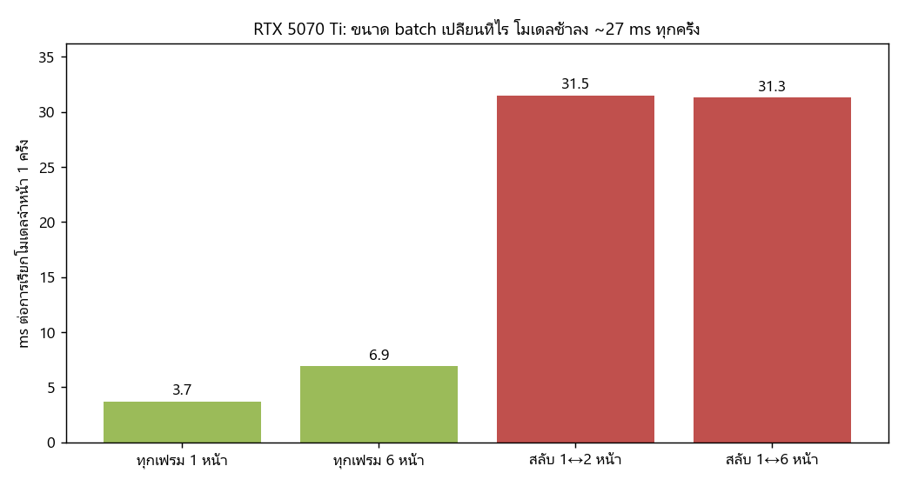
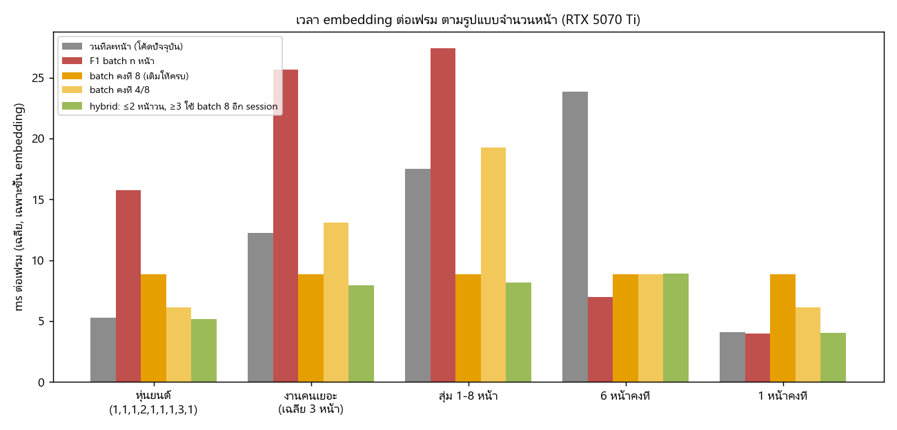
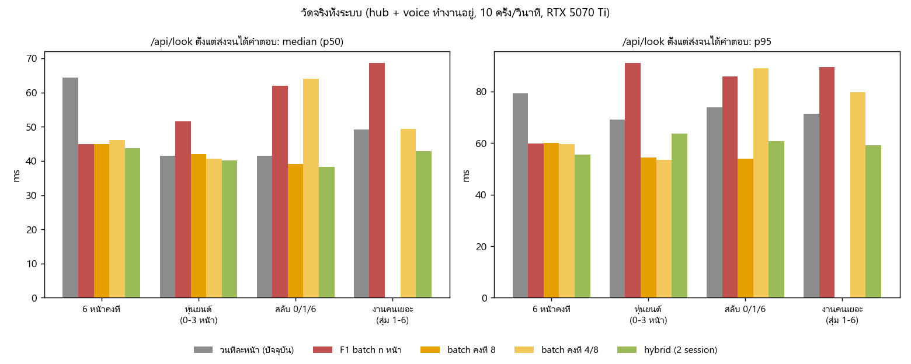
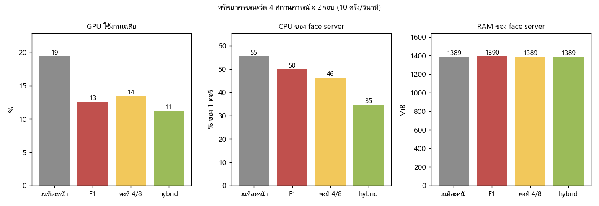

> **แทนที่ด้วย `friend_requests_to_send_2026-11-26.md` (ฉบับเดียวที่ส่งเพื่อน)**

# F1 batch embedding: ทำไมช้าลง และแก้ยังไง (วัดบน PC จริง 2026-11-26)

ไม่ได้แก้โค้ดของเพื่อนเลย ดึง `Face_Regonize` (main ที่ `26129fa`) มาอ่านและรันอย่างเดียว
ตัวที่ใช้ทดลองเป็นสำเนาในโฟลเดอร์ชั่วคราวฝั่งเรา ไม่อยู่ใน repo ของเพื่อน
เอกสารต้นทางของเพื่อน: `docs/experiments/2026-11-25-look-f1-batch-embedding.md`

## สรุปสั้น (แปะกลุ่มได้)

- **F1 ไม่ได้อยู่ใน main ของเพื่อน** commit ล่าสุด `26129fa` เป็นแค่เอกสาร เพื่อนลอง F1 แล้ววัดว่าแย่ลงเลย revert แล้ว
  สิ่งที่ "แย่ลง" คือผลของ F1 ตามที่เราขอในข้อ F1 ของ `speed_requests_2026-11-25.md` ไม่ใช่โค้ดจริงของเพื่อน
- **เพื่อนวัดถูก และเราขอผิดเอง** ตัวเลข "8 หน้า 39.5 → 11.7 ms" ที่เราใช้ขอ วัดด้วย batch ขนาดเดิมซ้ำทุกครั้ง
  เฟรมจริงจากหุ่นยนต์จำนวนหน้าเปลี่ยนทุกเฟรม
- สาเหตุ: บน onnxruntime 1.29 + CUDA (cuDNN 9) **ทุกครั้งที่ขนาด batch ของโมเดล recognition เปลี่ยน การเรียกนั้นช้าลงอีก ~27 ms**
  (บน RTX 5070 Ti ของเรา; บน RTX 4050 ของเพื่อนช้าลง 120-270 ms) (ครั้งแรกที่เจอขนาดใหม่แพงแค่ 40-120 ms)
- **ทางแก้ที่วัดแล้วว่าดีกว่าทุกแบบ: hybrid** ภาพ 1-2 หน้าใช้ลูปเดิมทีละหน้า (batch 1) ภาพ 3 หน้าขึ้นไปใช้ batch 8 ที่เติมให้ครบ
  บน **session ที่สอง** ซึ่งเห็น batch ขนาด 8 ตลอดเวลา ไม่เคยสลับขนาด เสีย VRAM เพิ่ม ~260 MiB
- ความแม่นเท่าเดิม: embedding ต่างกันที่ cos ≥ 0.9999997 (ตัวอย่างเล็ก ดูข้อจำกัด)



## เครื่องและวิธีวัด

| รายการ | ค่า |
|---|---|
| เครื่อง | PC โน้ตบุ๊ก RTX 5070 Ti Laptop 12 GB, driver 621, Windows 11 |
| ซอฟต์แวร์ | onnxruntime 1.29.0 (CUDA EP, ค่าเริ่มต้น), insightface buffalo_l, det_size 320, โหมด dual (live session แยก), ตามโค้ดเพื่อน `26129fa` |
| ที่รันอยู่ด้วย | hub (กล้อง USB + MJPEG), voice helper, Ollama, face backend ตัวจริงที่ `:8000` ที่ hub ยิง `/api/look` อยู่ตลอด, Chrome |
| ไม่ได้ทำ | ไม่ได้ยิงโหลดถอดเสียง/LLM ระหว่างวัด voice แค่เปิดค้างไว้ ดังนั้นตัวเลขนี้ไม่ใช่ "ตอนเสียงกำลังถอด" |
| ตัวทดลอง | สำเนาของ `backend/app` ที่ port `:8011`, ฐานข้อมูลและ storage แยก, แก้เฉพาะ `detect_faces()` ให้เลือกโหมดจากไฟล์ (loop / F1 / pad / hybrid) |
| ภาพทดสอบ | `t1.jpg` ของ insightface (6 หน้า) ปิดหน้าอื่นด้วยสีเทาเพื่อให้ได้ 0-6 หน้า ตรวจแล้วเซิร์ฟเวอร์เจอจำนวนหน้าตรงทุกภาพ |
| ยิง | client เดียว 10 ครั้ง/วินาที ครั้งละ 1 request, 20 วินาทีต่อช่อง, **สลับโหมด 2 รอบ** (ไป-กลับ) แล้วเฉลี่ย |
| ล็อก | วัดทั้งหมดถือ QC lock ของเครื่อง (`mice_qc_run.lock`) ไม่ชนกับรอบ QC ของงานอื่น (แต่งานอื่นที่ไม่ผ่าน lock อาจรบกวน ดูข้อจำกัด) |

สคริปต์วัดและข้อมูลดิบอยู่ใน `docs/experiments/2026-11-26_f1_batch_embedding/` (ฝั่งเรา)

## ผลที่ 1: ตัวโมเดล recognition อย่างเดียว (ms ต่อ 1 การเรียก)

batch คงที่ถูกมากและเร็วกว่าลูปจริง แต่สลับขนาดแล้วแพงมาก:

| รูปแบบ | ms ต่อการเรียก (median) |
|---|---:|
| ทุกครั้ง 1 หน้า | 3.7 |
| ทุกครั้ง 6 หน้า | 6.9 (ลูป 6 ครั้ง ≈ 22-24) |
| ทุกครั้ง 8 หน้า | 8.8 |
| สลับ 1 ↔ 2 หน้า | **31.5** |
| สลับ 1 ↔ 6 หน้า | **31.3** |
| `cudnn_conv_algo_search=HEURISTIC` สลับ 1 ↔ 6 | 31.5 (ไม่ช่วย) |
| `cudnn_conv_algo_search=DEFAULT` | 14.6 ที่ batch 1 (ช้ากว่า) และสลับก็ยังช้า 28.3 |

เวลา embedding ต่อเฟรม (ms, เฉลี่ย, ไม่รวม detect/decode) แยกตามรูปแบบจำนวนหน้า:



| รูปแบบจำนวนหน้า | วนทีละหน้า (ปัจจุบัน) | F1 batch n | batch คงที่ 8 | batch คงที่ 4/8 | **hybrid** |
|---|---:|---:|---:|---:|---:|
| หุ่นยนต์ 1,1,1,2,1,1,1,3,1 | 5.3 | 15.7 | 8.9 | 6.1 | **5.1** |
| งานคนเยอะ (Poisson เฉลี่ย 3, 1-8) | 12.2 | 25.7 | 8.9 | 13.1 | **8.0** |
| สุ่ม 1-8 หน้า | 17.5 | 27.4 | 8.8 | 19.3 | **8.1** |
| 6 หน้าคงที่ | 23.9 | **7.0** | 8.8 | 8.9 | 8.9 |
| 1 หน้าคงที่ | 4.1 | 4.0 | 8.8 | 6.1 | **4.0** |

F1 ชนะเฉพาะกรณี "จำนวนหน้าคงที่ที่เยอะ" เท่านั้น ที่เหลือแย่กว่าลูปเดิมทั้งหมด

## ผลที่ 2: ทั้งระบบ `/api/look` (ms, client ส่งจนได้คำตอบ)



| สถานการณ์ | ลูปเดิม p50 / p95 | F1 batch p50 / p95 | batch คงที่ 4/8 | batch คงที่ 8 (รอบแรก) | **hybrid p50 / p95** |
|---|---|---|---|---|---|
| 6 หน้าคงที่ | 64.3 / 79.3 | 45.0 / 59.9 | 46.1 / 59.6 | 45.0 / 60.2 | **43.7 / 55.6** |
| หุ่นยนต์ (0-3 หน้า) | 41.6 / 69.0 | 51.7 / 91.0 | 40.7 / 53.5 | 42.0 / 54.5 | **40.2 / 63.5** |
| สลับ 0/1/6 หน้า | 41.6 / 73.8 | 62.0 / 85.8 | 64.0 / 88.9 | 39.1 / 53.9 | **38.3 / 60.6** |
| งานคนเยอะ (สุ่ม 1-6) | 49.2 / 71.5 | 68.7 / 89.5 | 49.4 / 79.7 | ไม่ได้วัด | **42.8 / 59.1** |

- F1 ล้วนๆ: 6 หน้าคงที่ดีขึ้น 19 ms แต่หุ่นยนต์ช้าลง 10 ms (p50) และ p95 แย่ลง 22 ms, สลับ 0/1/6 และงานคนเยอะช้าลง 20 ms
- **hybrid ดีกว่าหรือเท่าลูปเดิมในทุกสถานการณ์** ที่วัด (p50 ดีขึ้น 1-21 ms)
- ตัวเลขแอปจริงที่ `:8000` ตอน hub ยิงอยู่ (ลูปเดิม) สูงกว่านี้ (p50 46-83, p95 145-187 ms) เพราะแชร์คิวกับ hub
  สำเนาที่ `:8011` มีแต่ client ของเรายิง จึงต่ำกว่า เทียบกันได้เฉพาะภายในตารางนี้
- ตัวเลขรอบสองคือ loop/F1/4-8/hybrid (4 สถานการณ์), ส่วน "batch คงที่ 8" มาจากรอบแรก (3 สถานการณ์) ลูปเดิมและ F1 วัดทั้งสองรอบได้ใกล้กัน
  (ลูป 6 หน้า 61.3 / 73.2 รอบแรก, F1 6 หน้า 42.8 / 54.8 รอบแรก)

## ผลที่ 3: ทรัพยากร (face server ระหว่างวัด)



| โหมด | GPU ใช้งาน | CPU ของ face server | RAM ของ face server |
|---|---:|---:|---:|
| ลูปเดิม | 19% | 55% ของ 1 คอร์ | 1389 MiB |
| F1 | 13% | 50% | 1390 MiB |
| batch คงที่ 4/8 | 14% | 46% | 1389 MiB |
| hybrid | 11% | 35% | 1389 MiB |

- GPU/CPU ลดลงตามจำนวนการเรียกโมเดลที่น้อยลง RAM ไม่ต่าง
- VRAM: session ที่สองของ hybrid ใช้เพิ่ม **~260 MiB** (วัดแยก; session แรก ~358 MiB) VRAM รวมทั้งเครื่องขยับ ±150 MiB ตามแอปอื่น เลยแยกผลของโหมดออกจากตัวเลขรวมไม่ได้
- GPU ใช้งานน้อยมากทุกโหมด (10-20%) และคล็อกต่ำ (600-1000 MHz) เพราะโหลดแค่ 10 ครั้ง/วินาที ตัวเลข % เทียบกันได้เฉพาะในตารางนี้

## ทำไมถึงช้าลง (สาเหตุ)

1. **ขนาด batch เปลี่ยน = เสียเวลา ~27 ms ต่อการเรียก** วัดซ้ำได้ ทุกครั้งที่ขนาดต่างจากครั้งก่อน (1→2, 2→1, 1→6, 6→1 เท่ากันหมด)
   ไม่เกี่ยวกับว่าเล็กหรือใหญ่ ขนาดคงที่ไม่เสีย ค่านี้ไม่ลดลงตามจำนวนครั้งที่เจอ (สลับ 1 ↔ 6 ซ้ำ 240 ครั้ง ก็ยังช้าเท่าเดิม)
   ตัวเลือก cuDNN algo search (HEURISTIC / DEFAULT) ไม่ช่วย ผลตรงกับที่เพื่อนวัดบน RTX 4050 (เพื่อนเจอ 120-270 ms)
   เรายังไม่ได้ไล่ภายใน onnxruntime ว่าโค้ดส่วนไหนทำให้ช้า รู้แค่ผลที่วัดได้
2. **หุ่นยนต์ส่งจำนวนหน้าเปลี่ยนทุกเฟรม** (1,1,1,2,1,0,1,1,3,1) F1 ที่ batch ตามจำนวนหน้าจริงจึงสลับขนาดตลอด
   ลูปเดิมเรียกด้วย batch 1 เสมอ จึงไม่โดนเลย
3. **ครั้งแรกที่เจอ batch ขนาดใหม่แพงแค่เล็กน้อย** วัดบน session สด: ครั้งแรกของ process 0.8 วินาที (batch 1)
   ขนาดใหม่ถัดไปครั้งแรกละ 40-120 ms (ก็เท่ากับค่าสลับขนาดปกติ) ไม่ใช่หลายวินาที ดังนั้นการวอร์มช่วยได้น้อย
4. ตัวเลขที่เราใช้ขอ F1 ตอนแรกมาจาก batch 8 คงที่ซ้ำ (ไม่มีการสลับ) จึงดูดีเกินจริง

## Fix list (เรียงตามความสำคัญ)

**ไม่ต้องแก้อะไรเลยก็ได้ ถ้าไม่อยากเพิ่มความซับซ้อน** โค้ดปัจจุบัน (ลูปเดิม) ไม่ผิด F1 ที่ revert ไปแล้วถูกต้องแล้ว
ทางเลือกด้านล่างเป็นทางที่วัดแล้วว่าเร็วขึ้นจริง ถ้าจะทำ

| # | ทำอะไร | เหตุผลและตัวเลข | ความเสี่ยง |
|---|---|---|---|
| X1 | **อย่าทำ batch ตามจำนวนหน้าจริง** (F1 แบบที่ revert ไป) ยืนยันตามที่เพื่อนตัดสิน | หุ่นยนต์ p95 69 → 91 ms, สลับ 0/1/6 p50 42 → 62 ms | ไม่มี |
| X2 | **ถ้าจะ batch ให้ทำ hybrid**: ≤ 2 หน้า ใช้ `rec_model.get()` ทีละหน้าเหมือนเดิม; ≥ 3 หน้า เติมภาพให้ครบ 8 (ใช้ภาพสุดท้ายซ้ำ) แล้วเรียก **session recognition ตัวที่สอง** ที่ได้รับ batch 8 ตลอด ถ้ามากกว่า 8 หน้าแบ่งเป็นก้อนละ 8 แล้วตัดแถวที่เติมทิ้ง | ต่อเฟรม: หุ่นยนต์ 5.3 → 5.1 ms (เท่าเดิม), งานคนเยอะ 12.2 → 8.0, 6 หน้า 23.9 → 8.9 ทั้งระบบ p50 ดีขึ้น 1-21 ms ไม่แย่กว่าลูปเดิมทุกสถานการณ์ GPU 19 → 11%, CPU 55 → 35% | VRAM +260 MiB ต้องมีเทสต์ว่าผล embedding เท่าเดิม |
| X3 | **อย่าให้ session ใดเห็น batch มากกว่าหนึ่งขนาด** ในโหมด dual ให้ session live ใช้ batch 1 เท่านั้น และ session batch-8 แยกต่างหาก ห้ามส่ง batch ขนาดอื่น (รวม `detect_faces_batch` ของ `/api/look/batch` ที่ยังส่งขนาดเปลี่ยนไปมา ควรเติมเป็น 8 และใช้ session เดียวกับ X2) | ต้นเหตุคือการสลับขนาด ไม่ใช่ batch เอง | `/api/look/batch` ยังไม่ได้วัดจริง เพื่อนเขียนไว้เองว่าอาจโดนเหมือนกัน |
| X4 | (เล็กน้อย) **วอร์ม batch 1 และ batch 8 ตอนเริ่มโปรแกรม** ใน `init_live_lane` ทั้งสอง session | ครั้งแรกของ process 0.8 วินาที, ขนาดใหม่ครั้งแรก 40-120 ms (ข้อ 3 ข้างบน) เพื่อนวอร์ม batch 1 อยู่แล้ว | ไม่มี ทำก่อนเปิดรับงาน |
| X5 | **วัดแบบสตรีมจริงเสมอ** อย่าวัดด้วยภาพเดียวหรือจำนวนหน้าคงที่ ใช้ลำดับจำนวนหน้าที่สลับ เช่น 1,1,1,2,1,0,1,1,3,1 และดู p95 ไม่ใช่แค่ median | ตัวเลข batch คงที่หลอกเรา (และเราหลอกเพื่อน) | ไม่มี |
| X6 | ถ้าไม่ทำ X2 ก็ไม่ต้องแก้ F2-F7 ที่เหลือใน `speed_requests_2026-11-25.md` เปลี่ยนแปลง (F2 หลีกทางเสียง, F4 จำกัด VRAM ฯลฯ) ข้อ F1 ให้ถือว่า "ปิด: ไม่ทำ" | | |

ตัวอย่างโค้ดของ hybrid (ใน `detect_faces`, แนวคิดเท่านั้น เราไม่ได้แก้โค้ดเพื่อน):

```python
if len(faces) <= 2:
    for face in faces:
        rec_model.get(image_bgr, face)                    # batch 1 เสมอ เหมือนเดิม
else:
    aligned = [face_align.norm_crop(image_bgr, landmark=f.kps, image_size=112) for f in faces]
    for i in range(0, len(aligned), 8):
        chunk = aligned[i:i + 8]
        real = len(chunk)
        chunk = chunk + [chunk[-1]] * (8 - real)         # เติมให้ครบ 8 เสมอ
        feats = big_session_feat(chunk)[:real]            # session ที่เห็น batch 8 เท่านั้น
        ...
```

## ความแม่น

เทียบ embedding ของลูปเดิมกับ batch n และกับ batch 8 ที่เติมภาพ: 1 ภาพ (6 หน้า) cos ต่ำสุด 0.9999998 / 0.9999998,
ความต่างสูงสุดต่อมิติ 9.4e-5 / 7.5e-5 เพื่อนวัดบน 198 ภาพ 210 หน้าแล้ว ไม่มีการตัดสินใจเปลี่ยน เรายืนยันได้แค่ตัวอย่างเล็ก
ก่อนใช้ hybrid จริงควรรันชุดภาพของเพื่อนซ้ำ (บนภาพ degrade ที่คะแนนใกล้ 0.45) และดูว่าไม่มีใครพลิกผล

## ข้อจำกัดของการวัดนี้

- ภาพทดสอบมาจากภาพเดียว (`t1.jpg`) ไม่ใช่ใบหน้าผู้ใช้จริงและกล้องจริง
- โหลดคือ client เดียว 10 ครั้ง/วินาที ไม่ใช่หลายหุ่นยนต์พร้อมกัน ไม่ได้ยิงถอดเสียง/LLM ระหว่างวัด
- GPU และ CPU ของเครื่องมีงานอื่นของเราทำอยู่ด้วยบางช่วง (QC อีกงาน, bench เสียง) ไม่ผ่านการล็อกเสมอไป
  แก้ด้วยการวัดสลับโหมด 2 รอบ (ไป-กลับ) แต่ตัวเลขช้าบางช่องอาจเป็นเสียงรบกวน
- 8 จาก 56 ช่อง (ทุกโหมดรวมลูปเดิม และทั้งหมดอยู่ในรอบแรก) มี request หนึ่งตัวที่ค้างจน client ตัดทิ้ง ระหว่างนั้น GPU/CPU ของ server ว่าง
  และ log ของ server ไม่มี error จึงสงสัยฝั่ง client/ระบบปฏิบัติการ ไม่ใช่โหมดไหนโดยเฉพาะ ยังไม่พบสาเหตุ
  p50/p95 ในตารางตัด request ที่ล้มเหลวออก (เหลือ 33-110 ตัวอย่างในช่องนั้น)
- ผลเป็นของ onnxruntime 1.29 + cuDNN บน RTX 5070 Ti ถ้าเปลี่ยนรุ่นไลบรารีหรือการ์ดต้องวัดใหม่
- `/api/look/batch` ยังไม่ได้วัดโดยตรง
