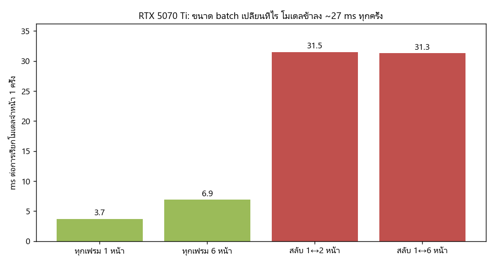
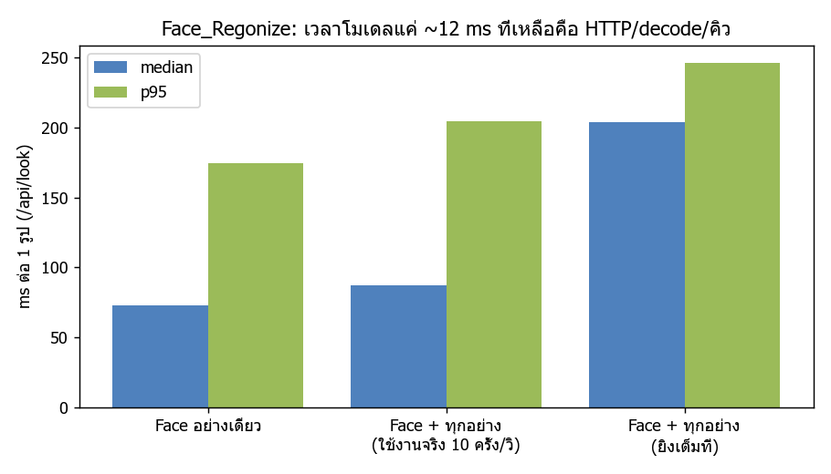
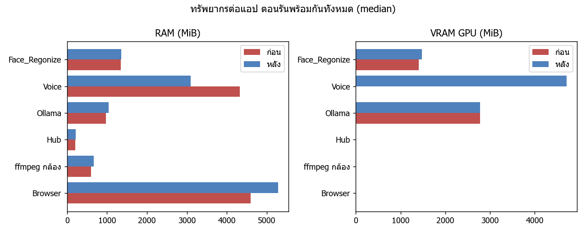
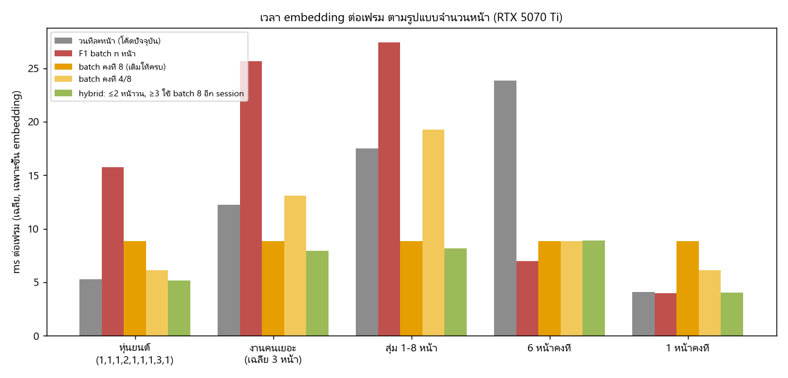
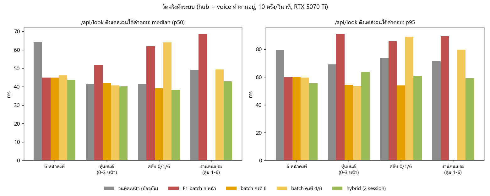
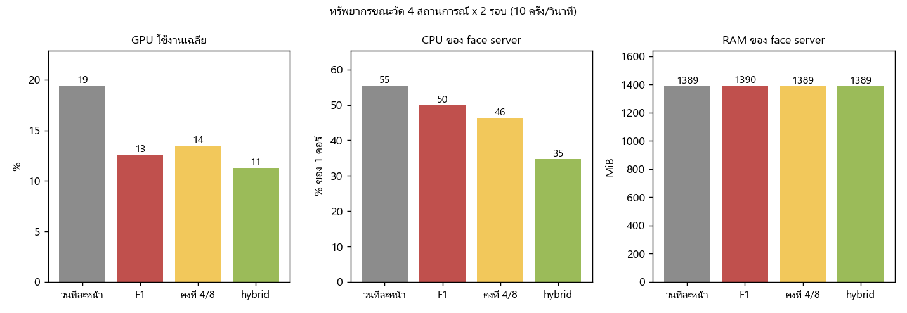

# ขอเพื่อน: รายการเดียวที่ต้องทำ (ฉบับส่งจริง) — 2026-11-26

ฉบับนี้ฉบับเดียว **แทนทุกฉบับก่อนหน้า** (`friend_requests_send_2026-11-25`, `face_f1_batch_embedding_2026-11-26`, `gpu_lease_request_2026-11-25`, `speed_requests_2026-11-25`)
ส่วนข้อตกลง hub↔แอพ (key, `ref`, webhook) อยู่ในฉบับเต็ม `friend_requests_all_2026-11-23.md` ยังใช้ตามนั้น

- เราไม่แก้โค้ดเพื่อน อ่านอย่างเดียวและวัดบน PC ของเรา (RTX 5070 Ti 12 GB) ฝั่งเราทำเสร็จและใช้ได้โดยไม่ต้องรอข้อไหน ไม่บังคับทุกข้อ
- **ความแม่นของการจำหน้าต้องเท่าเดิม** ข้อไหนทำให้พลาดมากขึ้น ไม่ต้องทำ
- ความลับ (key/secret) อย่าลง git เพราะ repo ของเรา public
- เรียงตามความสำคัญ **P1 ทำก่อน / P2 ควรมี / P3 ไว้ทีหลัง**
- ตัดออกแล้ว (เพื่อนทำเสร็จ ขอบคุณ): Face tags, นำเข้า Tags, `/api/look/batch`, ขีดจำกัดใน health, threshold ต่อกล้อง, All-Jao ส่งผลชนะ + ชื่อผู้เล่น, Help ของทั้งสามแอพ

## ต้องแก้ก่อน: ข้อขอ F1 เดิมของเราผิดเอง

เราเคยขอให้ทำ embedding ทุกหน้าเป็น batch เดียว (F1) เพื่อนลองแล้ววัดว่าช้าลงเลย revert ไป **เพื่อนถูก เราขอผิด** ให้ยกเลิกข้อ F1 เดิม
ตัวเลข "8 หน้า 39.5 → 11.7 ms" ที่เราใช้ขอ วัดด้วย batch ขนาดเดิมซ้ำทุกครั้ง แต่เฟรมจริงจากหุ่นยนต์จำนวนหน้าเปลี่ยนทุกเฟรม
สาเหตุ (วัดแล้ว): บน onnxruntime 1.29 + CUDA **ทุกครั้งที่ขนาด batch ของโมเดล recognition เปลี่ยน การเรียกนั้นช้าลง ~27 ms** (RTX 5070 Ti ของเรา; RTX 4050 ของเพื่อน 120-270 ms)
ขนาดคงที่ไม่เสีย การตั้ง `cudnn_conv_algo_search` ไม่ช่วย ตอนนี้ hybrid (ข้อ 6) เป็นตัวเลือกที่วัดแล้วดีที่สุดในตอนนี้ แต่ **ยังรอผลทดสอบวิธีอื่นอยู่ ยังไม่ต้องทำ**



---

## รายการที่ขอ (เรียงตามความสำคัญ)

### P1 — ทำก่อน

**1. Face_Regonize: ตั้ง `JWT_SECRET` จริงใน .env และเปลี่ยน admin/admin123**
repo เป็น public ค่า default เดาได้ ใครก็ปลอม token ได้

**2. Face_Regonize + Photobooth: รับกล้องเป็นลิงก์ MJPEG ของ hub ไม่เปิดกล้องเอง**
URL: `http://127.0.0.1:8642/api/dev/cam.stream?dev=pc:<ชื่อกล้อง>` (ภาพเดียว: `/api/dev/cam.jpg?dev=...`, รายการกล้อง: `/api/cameras`)
- Face: ช่อง "Stream URL" ต่อ camera node (backend อ่านเฟรมเองเหมือน `video_devices.py`)
- Photobooth: เลือกแหล่งกล้องเป็นลิงก์ได้ และถ้าอัดวิดีโอ ใช้ `h264_nvenc`
เหตุผล: Windows ให้โปรแกรมเดียวถือกล้อง เปิดซ้ำ = busy/ภาพดำ, ESP32-CAM รับสตรีมได้ทีละ 1 และถ้าจำหน้าสองทางจะทำงานซ้ำเสีย GPU สองเท่า
ถ้า Face เปิดกล้องเองก่อน ให้เผยเป็นสตรีม MJPEG อ่านอย่างเดียวในเครื่อง แล้วบอกที่อยู่ให้เรา (เราลิงก์ต่อให้)

**3. Face_Regonize: หลีกทางให้เสียง และขอคิว GPU จาก hub**
ตอนทุกแอพทำงานหนักพร้อมกัน face กิน GPU ~95% ทำให้ถอดเสียงช้าจาก 0.75 เป็น 2.8 วินาที (/ask 0.06 → 2.9 วิ)
- ให้งานเบื้องหลัง (Event Photo, import, วิดีโอ, enrollment, kiosk/camera node, `photo_processing_service.py`) เรียก `yield_to_interactive()` ที่มีอยู่แล้ว ส่วน `/api/look` ของหุ่นทำต่อ
- ครอบเฉพาะส่วนโมเดล (forward pass) ด้วยการขอคิวจาก hub (ห้ามบล็อก ถ้า error หรือ 408 ให้ทำงานต่อเลย):
```
POST http://127.0.0.1:8642/api/scheduler/acquire  {"class":"live","owner":"face","wait":20} -> {"ok":true,"token":"L12"}
POST http://127.0.0.1:8642/api/scheduler/release  {"token":"L12"}
```
  เฉพาะเครื่องเดียวกัน (loopback), ไม่คืนใน 60 วิ hub ยึดคืนเอง ชั้น (class): `live` 0 (คนรอ: จำหน้าทักทาย), `speech` 1, `normal` 5, `background` 9 (enroll เยอะๆ, ทำดัชนีใหม่, วิดีโอ)
  ตัวช่วยคัดลอกได้ ~10 บรรทัด: `tools/jobsched.py` คลาส `LeaseClient`
- ผล: ระหว่างงานยาว งานสดของหุ่นหรือเสียงรอแค่ 1 การเรียกโมเดล ไม่ใช่ทั้งงาน




**4. All-Jao-Games: ส่งข้อมูลให้ครบใน `alljao:win`**
- quiz ส่ง `result.total` (คะแนนเต็มรอบ) — ตอนนี้ยังไม่มี ตั้งเกณฑ์ "80%" ไม่ได้
- วงล้อส่ง `result.noPrize: true` ที่ช่อง "ลองใหม่" — ตอนนี้เราเดาจากคำ เปลี่ยนคำแล้วแจกของผิด
- เกมจับคู่ใส่ `playerName` ใน record (`matching-game.js:104`)
- ช่องชื่อผู้เล่นหน้าวงล้อ/ตู้คีบแสดง `???????????` เปลี่ยนป้ายเป็น «ชื่อผู้เล่น»

**5. Photobooth: เชื่อมกับ hub ได้โดยไม่ต้องจับคู่มือ**
- รับ `Authorization: Bearer <โทเค็นบริการ>` ที่ localhost (ที่พอร์ต AdminAuthenticator ไม่ต้อง cookie/pairing/CSRF)
- เริ่มใหม่แล้วขึ้น "Kiosk not paired" (401 `/api/booth/frames`) มือใหม่ติด ให้หน้าบอกวิธีจับคู่ หรือจับคู่เองที่ localhost
- ส่ง event ตอนถ่ายเสร็จ (`session.finished` + session id + วิธีรับภาพที่ผู้ใช้เลือก) ให้หุ่นพูด/แจกของได้

### P2 — ควรมี

**6. Face_Regonize: batch embedding — ⏳ รอผลทดสอบ ยังไม่ต้องทำ**
เรากำลังทดสอบวิธีอื่นที่อาจดีกว่า hybrid อยู่ จะแจ้งวิธีสุดท้ายอีกครั้ง ตอนนี้ไม่ต้องแก้อะไร (โค้ดปัจจุบันไม่ผิด) ข้อมูลข้างล่างเป็นผลทดสอบ hybrid ไว้อ้างอิงเท่านั้น
- ภาพ ≤ 2 หน้า: `rec_model.get()` ทีละหน้าเหมือนเดิม (batch 1)
- ภาพ ≥ 3 หน้า: เติมภาพสุดท้ายซ้ำให้ครบ 8 แล้วเรียก **session recognition ตัวที่สอง** ที่เห็น batch 8 ตลอด (มากกว่า 8 หน้าแบ่งก้อนละ 8 แล้วตัดแถวที่เติมทิ้ง) เสีย VRAM เพิ่ม ~260 MiB
- **อย่าให้ session ใดเห็น batch มากกว่าหนึ่งขนาด** รวม `/api/look/batch` (ควรเติมเป็น 8 และใช้ session เดียวกัน; เรายังไม่ได้วัด endpoint นี้โดยตรง)
- วอร์ม batch 1 และ batch 8 ตอนเริ่มโปรแกรม (`init_live_lane` ทั้งสอง session)
- ห้ามทำ batch ตามจำนวนหน้าจริง (F1 แบบที่ revert) — หุ่นยนต์ p95 69 → 91 ms
- วัดด้วยสตรีมจริงเสมอ (จำนวนหน้าสลับ เช่น 1,1,1,2,1,0,1,1,3,1 และดู p95) ไม่ใช่ภาพเดียว/จำนวนหน้าคงที่
- ก่อนใช้จริงรันชุดภาพของเพื่อนซ้ำ (ภาพ degrade ที่คะแนนใกล้ 0.45) ว่าไม่มีใครพลิกผล (เราเทียบ embedding ได้ cos ≥ 0.9999997 บนตัวอย่างเล็ก)

| จำนวนหน้า (ms ต่อเฟรม เฉพาะ embedding) | ลูปเดิม | F1 | **hybrid** |
|---|---:|---:|---:|
| หุ่นยนต์ 1,1,1,2,1,1,1,3,1 | 5.3 | 15.7 | **5.1** |
| งานคนเยอะ (1-8 หน้า) | 12.2 | 25.7 | **8.0** |
| 6 หน้าคงที่ | 23.9 | 7.0 | 8.9 |

| ทั้งระบบ `/api/look` p50 / p95 (ms) | ลูปเดิม | F1 | **hybrid** |
|---|---|---|---|
| 6 หน้าคงที่ | 64.3 / 79.3 | 45.0 / 59.9 | **43.7 / 55.6** |
| หุ่นยนต์ (0-3 หน้า) | 41.6 / 69.0 | 51.7 / 91.0 | **40.2 / 63.5** |
| สลับ 0/1/6 หน้า | 41.6 / 73.8 | 62.0 / 85.8 | **38.3 / 60.6** |
| งานคนเยอะ | 49.2 / 71.5 | 68.7 / 89.5 | **42.8 / 59.1** |

GPU 19 → 11%, CPU 55 → 35% (ลูปเดิม → hybrid)





**7. Face_Regonize: ใช้งานบนมือถือและหลายภาษา**
- มือถือ 390 px พัง: sidebar กว้าง ~255 px เนื้อหาเหลือ ~135 px ตารางถูกตัด ให้ยุบ sidebar ต่ำกว่า ~768 px; URL ไม่มีอยู่ (`/nonexistent`) แสดงหน้าว่าง ให้มีหน้า "ไม่พบหน้านี้"
- อ่าน `?lang=th|en|zh|ja` จาก address แล้วจำไว้ (hub ต่อให้ทุกลิงก์) — Photobooth และ All-Jao ก็เหมือนกัน

**8. Face_Regonize: ข้อมูลและบัญชี**
- `person_id` คงที่ใน people / history / webhook (`/api/look` มีแล้ว)
- สร้าง machine account `robot-hub` (`scripts/manage_machine_user.py create`) ตอนนี้ไฟล์ล็อกอินของเราเป็น role admin

**9. Face_Regonize: จำกัด VRAM และเธรดของ onnxruntime**
`gpu_mem_limit` ~1.5-2 GB + `arena_extend_strategy=kSameAsRequested` ใน CUDA provider options, `intra_op_num_threads=2`, `inter_op_num_threads=1` ตอนนี้ VRAM 1.3-1.5 GB ขึ้นลง และ CPU พุ่งถึง 139% ตอนหนัก

**10. Face_Regonize: ย่อรูปใหญ่ตอน decode** (~12 MP จาก Event/มือถือ)
`cv2.IMREAD_REDUCED_COLOR_2/4` และ `INTER_LINEAR` เฉพาะรูปที่ต้องย่ออยู่แล้ว (decode 33 → 12-17 ms, ย่อ 4.4 → 0.7 ms) เช็คว่าจำนวนหน้าที่เจอเท่าเดิม

**11. All-Jao-Games: รายการเกมและ admin**
- หน้า admin และหน้าผู้เล่นใช้รายการเกมเดียวกัน (ตอนนี้ 4 vs 3) และมี `GET /api/games` หรือ `games.json` บอกเกมที่เปิดอยู่ (id, ชื่อ, เปิด/ปิด) เพื่อให้เกมใหม่เพิ่มได้โดยไม่แก้ฝั่ง hub; เกมใหม่ยิง `alljao:win` รูปแบบเดิม
- admin `admin/1234` เช็คในเบราว์เซอร์ ไม่ป้องกันจริง ให้ hub เป็น admin แทน หรือยอมรับว่าเกมไม่มี admin
- ที่อยู่ hub อ่านจากค่าตั้งได้ (ไม่ผูกพอร์ต 8642) และลองที่อยู่ที่สองเมื่อไม่ตอบ (`http://127.0.0.1:8654` แอพตู้รางวัลเปิดเดี่ยว)

**12. Photobooth: อื่นๆ ที่ทำให้เชื่อมแน่น**
- `/api/health` ตอบโดยไม่ต้องล็อกอิน (เช็ค `127.0.0.1:8123` เคยได้ 404) และบอกว่าใช้กล้องตัวไหน
- "วิธีส่งภาพ" (QR/พิมพ์/อีเมล) เป็นรายการตั้งค่าได้ บอกใน health; ข้อความหน้าแรกแก้จาก admin ได้ (อนาคตอาจมีเครื่องพิมพ์ จึงอย่าเขียนว่า QR ตายตัว)
- ถ้าต้องการภาพเต็ม 1080p ตอนถ่าย บอกเรา ฝั่งเราจะเพิ่มตัวเลือกคุณภาพกล้อง (ตอนนี้ hub ส่ง 640 px 10 fps)

### P3 — ไว้ทีหลัง

13. Face: `want=persons` ใน `/api/look` ตอบ 422 ให้ใช้ได้; `detected_at` ใส่โซนเวลา +07:00; webhook ตอนจำคนได้ `{name, person_id, node_id, tags, time}`; โหลดโมเดลตอนใช้ครั้งแรกและปล่อยเมื่อว่างนาน (คืน VRAM ~1.3 GB); (ทางเลือก) ลอง TensorRT FP16 ด้วย `trt_engine_cache_enable` เทียบคะแนนจับคู่ก่อนใช้
14. Photobooth: ชื่อคนจาก Reconize ในหน้าถ่ายรูป (ตัวแปลงตั้งค่าได้); `X-Frame-Options: DENY` → อนุญาต frame-ancestors เฉพาะ hub (`main.py:126`); endpoint อ่านอย่างเดียวสำหรับ robot (สถิติวันนี้) ไม่ต้อง login admin
15. All-Jao: server เปิดเองหลังเปิดเครื่อง (ตอนนี้ hub ต้องสั่งรัน); เกมในเบราว์เซอร์หยุดวาดตอน `document.hidden` (Chrome กิน RAM ~5 GB ตอนรันพร้อมกัน)
16. GPU encode/decode (ทุกแอพ): กล้อง PC ส่งภาพดิบ จึงไม่มีอะไรให้ NVDEC ถอด ใช้ GPU ได้จริงตอนอัด/สตรีมวิดีโอ: ffmpeg `h264_nvenc`/`hevc_nvenc` แทน `libx264` (ลด CPU/RAM มาก); รูป JPEG จำนวนมากลอง nvJPEG หรือ PyTurboJPEG แทน `cv2.imdecode`
17. รองรับการ์ดจอ AMD/Intel (ไม่ผูก CUDA): เลือก provider onnxruntime ตามที่มีจริง `CUDA → DirectML (onnxruntime-directml) → CPU` เก็บลำดับในไฟล์ตั้งค่า (`engine.py:158` ตอนนี้ระบุ CUDA+CPU); ทดสอบ provider จริงตอนเริ่มและแสดงชื่อใน status; เทียบความแม่นกับ CPU ก่อน; ส่วน nvJPEG/TensorRT/NVENC ต้องมีทางสำรอง (CPU, `h264_amf`, `h264_qsv`, `libx264`) ยังไม่ได้ทดสอบกับการ์ด AMD จริง

## ไม่ต้องทำ (วัดแล้วไม่ช่วย)
det_size 640 (ช้า + จำนวนหน้าเปลี่ยน), det_size 160 (พลาดหน้า), ปิด TF32 (ช้าลงมาก), FP16 บน CUDA (12.08 vs 11.97 ms), INT8/buffalo_s (แม่นลด), KV cache (ไม่ใช่ LLM), ตัวเลือก cuDNN algo search

## ข้อจำกัดของตัวเลข
ภาพทดสอบมาจากภาพเดียว (6 หน้า) client เดียว 10 ครั้ง/วินาที ไม่ใช่หุ่นยนต์หลายตัว ไม่ได้ยิงถอดเสียง/LLM ระหว่างวัดรอบ F1 และผลเป็นของ onnxruntime 1.29 บน RTX 5070 Ti ถ้าเปลี่ยนไลบรารีหรือการ์ดต้องวัดใหม่ ทดสอบกับของจำลอง ยังไม่ได้ลองกับกล้อง/หุ่นจริง
