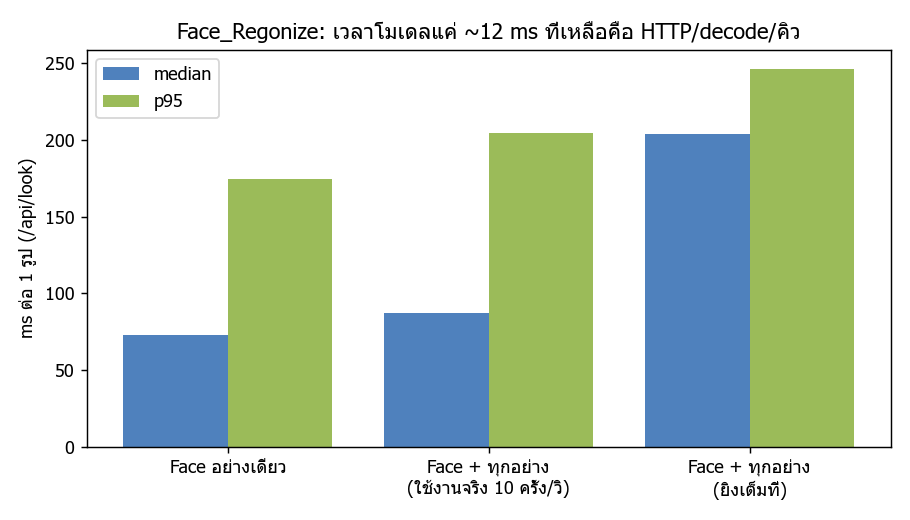
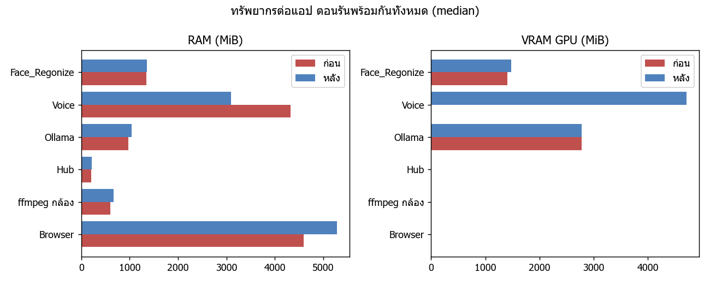

# ขอเพื่อนปรับแอปให้เร็วขึ้น รันพร้อมกันกับระบบเสียงได้ (2026-11-25)

ไม่ได้แก้โค้ดของเพื่อนเลย อ่านอย่างเดียว และวัดบน PC จริง (RTX 5070 Ti 12 GB)
รายงานเต็มฝั่งเรา: `docs/experiments/2026-11-25_all_apps_together.md`
ทุกข้อ **ความแม่นต้องเท่าเดิม** ถ้าข้อไหนทำให้จำหน้าพลาดมากขึ้น ไม่ต้องทำ

## สรุปสั้น (แปะกลุ่มได้)

- Face_Regonize ตอนนี้ 1 รูป 6 หน้าใช้ 42 ms ในเซิร์ฟเวอร์ แต่ตัวโมเดลจริงแค่ ~12 ms ที่เหลือคือทำทีละหน้า + แปลงรูป
- ตอนทุกแอปทำงานพร้อมกันแบบหนัก face กิน GPU 95% ทำให้ระบบเสียง (ถอดเสียง) ช้าลงจาก 0.75 เป็น 2.8 วินาที
- ขอ 6 ข้อ เรียงตามผล: batch ทีละหลายหน้า, หลีกทางให้เสียง, อ่านกล้องจาก hub, จำกัด VRAM/เธรด, ย่อรูปตอน decode, โหลดโมเดลเมื่อใช้

## Face_Regonize

| # | ขอให้ทำ | ทำไม (ตัวเลขวัดจริง) | สำคัญ |
|---|---|---|---|
| F1 | **ทำ embedding ทุกหน้าในรูปเดียวเป็น batch เดียว** ใน `/api/look` ปกติ: `engine.py:461` ยังวน `rec_model.get(image_bgr, face)` ทีละหน้า ใช้แบบเดียวกับ `engine.py:501` (`get_feat(aligned)`) ที่ทำไว้แล้วใน `/look/batch` | รูป 6 หน้า: server 42 ms; เคยวัด 8 หน้า วนลูป 39.5 ms → batch 11.7 ms (เร็ว 3.4 เท่า) ผลลัพธ์เหมือนเดิม | P1 |
| F2 | **หลีกทางให้เสียงตอนกำลังคุย**: เวลามีงานเสียง (hub บอกได้) ให้งานเบื้องหลัง (Event Photo, import, วิดีโอ, กล้องที่ไม่มีใครดู) พักหรือลดเฟรม ส่วน `/api/look` ของหุ่นยังทำต่อ ใช้ `yield_to_interactive()` ที่มีอยู่แล้วกับ `api/recognition.py` และ `photo_processing_service.py` ด้วย | stress: ถอดเสียง 0.75 → 2.8 s, /ask 0.06 → 2.9 s เพราะ GPU เต็ม | P1 |
| F3 | **อ่านกล้องจาก hub ไม่เปิดกล้องเอง** รับ URL `http://127.0.0.1:8642/api/dev/cam.stream?dev=pc:<ชื่อกล้อง>` (MJPEG) เป็นแหล่งกล้องของ camera node (ข้อ D1/G3 เดิม) | Windows ให้โปรแกรมเดียวถือกล้อง; เปิดซ้ำ = ภาพดำ และจำหน้าสองรอบ เปลือง GPU สองเท่า | P1 |
| F4 | **จำกัด VRAM และเธรดของ onnxruntime** ตั้ง `gpu_mem_limit` (~1.5-2 GB) + `arena_extend_strategy=kSameAsRequested` ใน CUDA provider options และ `intra_op_num_threads=2`, `inter_op_num_threads=1` ใน SessionOptions | ตอนนี้ VRAM 1.3-1.5 GB ขึ้นลงตามโหลด CPU พุ่งถึง 139% ตอนโหลดหนัก จำกัดไว้ทุกแอปจะไม่แย่งกันจนช้า | P2 |
| F5 | **ย่อรูปตอน decode** (รูปจาก Event/มือถือ ~12 MP): `cv2.IMREAD_REDUCED_COLOR_2/4` และ `INTER_LINEAR` แทน `INTER_AREA` เฉพาะรูปที่สุดท้ายต้องย่ออยู่แล้ว | decode 33 → 12-17 ms, ย่อ 4.4 → 0.7 ms ต้องเช็คว่าจำนวนหน้าที่เจอเท่าเดิม | P2 |
| F6 | **โหลดโมเดลตอนใช้ครั้งแรก และปล่อยเมื่อว่างนาน** (ตั้งเวลาได้) | ตอนไม่มีใครใช้ คืน VRAM ~1.3 GB ให้เสียง/LLM | P3 |
| F7 | (ทางเลือก) ลอง **TensorRT FP16** ด้วย `trt_engine_cache_enable=True` + `trt_engine_cache_path` ที่คงอยู่ เครื่องมี `TensorrtExecutionProvider` แล้ว (onnxruntime 1.29) | FP16 บน CUDA เคยวัดแล้วไม่ต่าง (12.08 vs 11.97 ms) TensorRT ยังไม่ได้วัด ต้องเทียบคะแนนจับคู่ที่ threshold จริงก่อนใช้ ถ้าไม่ต่างก็ไม่ต้องทำ | P3 |

ไม่ควรทำ (วัดแล้ว): det_size 640 (ช้า + จำนวนหน้าเปลี่ยน), det_size 160 (พลาดหน้า), ปิด TF32 (ช้าลงมาก), INT8/buffalo_s (แม่นลด)

## เรื่องกล้องและ GPU decode/encode (ทุกแอปของเพื่อน)

- กล้อง PC ตัวนี้ส่งภาพดิบ (nv12/yuyv) ไม่ใช่ H.264 ดังนั้น NVDEC ไม่มีอะไรให้ถอด และ NVENC ทำ JPEG ไม่ได้
  ใช้ GPU encode/decode ได้จริงตอน **อัดวิดีโอหรือสตรีม H.264/HEVC** เช่น Photobooth/วิดีโอสรุปงาน: ใช้ ffmpeg `-hwaccel cuda` + `h264_nvenc`/`hevc_nvenc`
  (เครื่องมี `h264_nvenc`, `hevc_nvenc`, `av1_nvenc`) แทน `libx264` จะลด CPU/RAM มาก แบบที่เคยเห็น GPU ใช้ ~800 MB แทน CPU ~20 GB
- รูป JPEG ที่ต้อง decode จำนวนมาก (Event Photo): ลอง nvJPEG (`torchvision.io.decode_jpeg(..., device="cuda")`) หรือ PyTurboJPEG แทน `cv2.imdecode` อย่าเรียก ffmpeg ใหม่ทุกรูป (เปิดโปรแกรมช้ากว่าโมเดล)

## Photobooth / All-Jao-Games

| # | ขอให้ทำ | ทำไม | สำคัญ |
|---|---|---|---|
| P1 | Photobooth อ่านกล้องจาก hub (URL MJPEG ข้างบน) ไม่เปิดกล้องเอง และถ้าอัด/ต่อวิดีโอ ใช้ `h264_nvenc` | กล้องเปิดได้โปรแกรมเดียว; NVENC ลด CPU/RAM | P1 |
| P2 | ถ้าต้องการภาพเต็ม 1080p ตอนถ่าย บอกเรา เราจะเพิ่มตัวเลือก "คุณภาพกล้อง" ที่ hub (ตอนนี้ hub ส่ง 640 px 10 fps) | ไม่ลดคุณภาพรูปที่ถ่าย | P2 |
| G1 | All-Jao-Games: เกมในเบราว์เซอร์ ใช้ `requestAnimationFrame` และหยุดวาดเมื่อแท็บไม่ได้เปิดอยู่ (`document.hidden`) | Chrome เป็นตัวกิน RAM มากสุดตอนรันพร้อมกัน (~5 GB) | P3 |

## Blackwell (RTX 50) ที่ต้องรู้

- ไลบรารี CUDA ต้องเป็น 12.8 ขึ้นไป (torch ต้องเป็น `cu128`) ไม่งั้นขึ้น `no kernel image is available` หรือค้างตอนเริ่ม
- Python บน Windows ไม่หา DLL จาก PATH: ใช้ `os.add_dll_directory()` กับโฟลเดอร์ `site-packages/nvidia/*/bin` (Face_Regonize มี `cuda_dlls.py` ทำแล้ว ดีมาก)

## รองรับการ์ดจอ AMD / Intel ด้วย (ไม่ใช่แค่ NVIDIA)

ฝั่งเรา: ตรวจชนิดการ์ดจออัตโนมัติ (`config/gpu_vendors.json` เพิ่มยี่ห้อ = เพิ่มแถว) NVIDIA ใช้ CUDA, AMD/Intel ให้ Ollama ใช้ Vulkan, ถอดเสียงตกไป CPU จนกว่าจะมีตัวรองรับ ไม่มีการ์ดเลยก็ใช้ CPU ทั้งหมด
ฝั่งเพื่อนขอให้ทำให้แอปไม่ผูกกับ CUDA อย่างเดียว:

| # | ขอให้ทำ | ทำไม |
|---|---|---|
| A1 | Face_Regonize เลือก provider ของ onnxruntime ตามที่เครื่องมีจริง ลำดับ: `CUDAExecutionProvider` (NVIDIA) → `DmlExecutionProvider` (AMD/Intel บน Windows ผ่านแพ็กเกจ `onnxruntime-directml`) → `CPUExecutionProvider` และเก็บลำดับไว้ในไฟล์ตั้งค่า ไม่เขียนตายตัว (ตอนนี้ `engine.py:158` ระบุ CUDA+CPU) | AMD ไม่มี CUDA ตอนนี้จะตกไป CPU ทั้งหมดและช้ามาก |
| A2 | ตอนเริ่มโปรแกรม ทดสอบ provider จริงด้วยรูปเล็กก่อนใช้ (มีใน `hardware_info_service.verified_providers` แล้ว) และแสดงชื่อ provider ที่ใช้อยู่ในหน้า status | `get_available_providers()` บอกว่ามีแต่ใช้ไม่ได้ถ้าขาดไลบรารี |
| A3 | ใช้เฉพาะฟังก์ชันที่ DirectML รองรับ ทดสอบความแม่น (คะแนนจับคู่) เทียบ CPU ก่อน ถ้าต่างเกินเกณฑ์ให้ตกไป CPU | ไม่ลดความแม่น |
| A4 | ส่วนที่ใช้ nvJPEG / TensorRT / `h264_nvenc` ต้องมีทางสำรองเสมอ: CPU decode, ffmpeg `h264_amf` (AMD) หรือ `h264_qsv` (Intel), และ `libx264` | NVENC ใช้ได้เฉพาะ NVIDIA |

ยังไม่ได้ทดสอบกับการ์ด AMD จริง (PC นี้เป็น NVIDIA) ฝั่งเราทดสอบการตรวจชนิดกับชื่อการ์ดจำลองเท่านั้น
