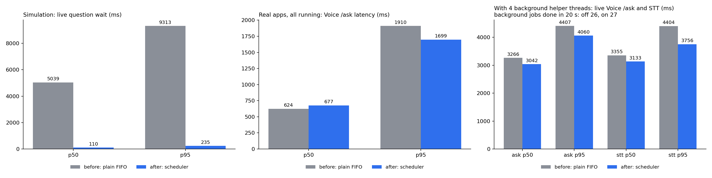
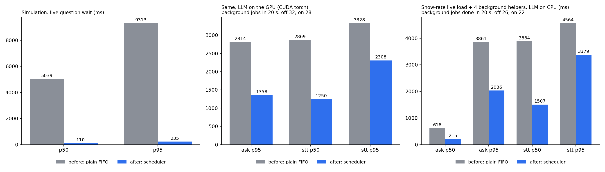

# Shared job scheduler: measurements, 2026-11-25

Branch `claude/project-thread-q4yvte` (PR #259: `tools/jobsched.py`, `config/scheduler.json`,
`main_python/hub_api_scheduler.py`). No model, setting or quality was changed for these runs.

## 1. Simulation (`tools/bench_sched.py`)

4 background workers each run 12 pieces of 0.25 s on one GPU, 8 live questions of 0.15 s arrive
every 0.6 s. "Before" is a plain lock (what Voice had), "after" is the scheduler with `config/scheduler.json`.

| | plain lock | scheduler |
|---|---|---|
| live question wait p50 | 5039 ms | 110 ms |
| live question wait max | 9313 ms | 235 ms |
| all background work done | 13.20 s | 13.31 s |

A live question waits about 46x less. Background work finishes 0.1 s later (under 1%), so it is
delayed a little and never starved. Raw: `.local/perf/sched_sim.json`.

## 2. Real apps (`tools/perf_load.py --seconds 20`)

Everything running together: the branch hub, the branch Voice (real Whisper on the GPU), the real
face app (`/api/look`), and the PC camera stream. Each workload runs as fast as it is answered.
Workloads: face, voice `/ask`, stt `/transcribe`, camera. The local LLM (`llm`) was not running on
this PC, so it was left out. The STT clips were three short English sentences made with Windows
speech (the PC had no clips in `apps/voice/tts_cache`).

"Scheduler off" is `lease.enabled=false` and every class at priority 5 (plain FIFO).

"together", median / p95 in ms (calls in 20 s):

| workload | alone | scheduler OFF | scheduler ON (run 1) | scheduler ON (run 2) |
|---|---|---|---|---|
| voice `/ask` | 49 / 1069 | 624 / 1910 (23) | 677 / 1699 (23) | 661 / 1686 (23) |
| stt `/transcribe` | 512 / 605 | 644 / 1791 (23) | 651 / 1756 (23) | 631 / 1791 (23) |
| face `/api/look` | 74 / 177 | 76 / 185 (210) | 75 / 178 (209) | 77 / 185 (204) |
| camera frame | 94 / 125 | 94 / 126 (201) | 95 / 112 (201) | 94 / 124 (201) |

Reading it honestly:

* The scheduler adds no measurable cost. ON and OFF are inside run-to-run noise (voice p50 624 to 677,
  p95 1686 to 1910; the two ON runs differ from each other by about as much as ON differs from OFF).
* It does not speed these workloads up, and it was not expected to. In this test every GPU job is the
  same kind: `/ask` and `/transcribe` are both class `live`. Priority only helps when a lower class
  (translation, helper, warm-up) is in the queue at the same time. That case is section 1.
* The big slowdown from "alone" to "together" (voice `/ask` 49 ms to about 650 ms) is Whisper and the
  face app sharing one GPU with the workloads running flat out. It is the cost of the single GPU,
  not of the queue.
* The face app is a separate program that does not ask the hub for a GPU turn yet, so its jobs are not
  ordered by this scheduler. Only Voice and hub tools are.

## 2b. Real apps with a background load beside the live work

Same setup as section 2, plus 4 threads of background work for 20 s:
`python tools/perf_load.py --seconds 20 --together-only --only face,voice,stt,camera --helpers 4`.
Each background call is `POST /translate` with a Thai sentence and no target: the Voice helper
translates it to English with the local model (Qwen2.5-0.5B, in the Voice process). That runs under
the scheduler's `helper` class (priority 6), the kind of job a live question should overtake.
What it really takes: the local model runs on the CPU on this PC (the Voice status says
"cannot confirm GPU, using CPU" for the LLM; Whisper is on the GPU), about 0.55 s per job.
It is a real background job, but it competes for the CPU and the Python process as much as for the GPU.
The web translation path (Google first) was not used: it never touches the GPU gate.
Two runs per setting, scheduler OFF = `lease.enabled=false` and every class at priority 5.

"together", median / p95 in ms; background = helper jobs finished in 20 s:

| | OFF run 1 | OFF run 2 | ON run 1 | ON run 2 |
|---|---|---|---|---|
| voice `/ask` | 2829 / 3936 | 3704 / 4878 | 3005 / 4048 | 3078 / 4073 |
| stt `/transcribe` | 2933 / 3547 | 3777 / 5261 | 3416 / 3742 | 2850 / 3770 |
| background jobs done | 30 | 23 | 28 | 26 |
| face `/api/look` | 70 / 167 | 67 / 184 | 70 / 166 | 70 / 164 |

Means: voice `/ask` p50 3266 (off) vs 3042 (on); stt p50 3355 vs 3133; background jobs 26.5 vs 27.
The runs differ from each other by more than ON differs from OFF (OFF run 1 is faster than ON, OFF run 2
slower), so this does not show an improvement. It shows no starvation either: background throughput
is the same.

Why the scheduler could not help here, from the Voice scheduler stats after the run
(`/health` `scheduler.classes`): the wait at the gate was 0 ms at p50 and p95 for every class
(live, helper, background). Jobs reached the gate one at a time, so there was no queue for priority
to reorder. A helper job holds the gate for about 0.55 s, but a caller waits about 3 s, so the
queueing happens before the gate (the Voice job pool, locks, or CPU and Python-process contention
from the local model); this test did not find which. A live `/ask` that is answered from the saved
FAQ does not use the gate at all. To make the gate the limit, the background job must be GPU-bound and
the live job must also take the gate (a question that needs the local model), or the work before the
gate must stop serializing. That is a finding for the PR, not a result of the scheduler.

## 2c. Why section 2b showed nothing, and what the scheduler does once that is out of the way

**Re-test with the pool fix (`6b11e610`, a single job skips the FIFO pool).** Same load as 2b, 2 runs each.
Gate wait stayed 0 ms in every class and latency stayed about 3 s (voice `/ask` 2784 to 2994 ms p50 both
ways, STT 2831 to 3262 ms). The pool was not the only thing in front of the gate.

**Cause found: `apps/voice/profiles.py` `guarded()`.** It wraps every `do_GET` and `do_POST` of the Voice
HTTP handler in `with brain.profile_lock:` (a `threading.RLock`), so the whole request, including
the time it waits at the priority gate and runs the model, holds one global lock. Requests reach the gate
one at a time, in arrival order, and the priority gate never sees a queue. (The lock exists so that a character
switch cannot split a request between two characters.)

**Experiment, not shipped:** a harness (outside the repo) replaced `guarded` by the identity before
`service.py` imported it, so requests no longer share that lock. Everything else is the branch as pushed.
Two runs per setting. Scheduler OFF = `lease.enabled=false` and every class at priority 5.

Live load flat out (each live workload loops as fast as it is answered; helper = 4 background threads),
median / p95 ms and calls in 20 s:

| | OFF 1 | OFF 2 | ON 1 | ON 2 |
|---|---|---|---|---|
| voice `/ask` (saved-answer path) | 44 / 3322 (28 calls) | 45 / 3765 (23) | 60 / 1423 (58) | 51 / 1424 (58) |
| stt `/transcribe` | 3175 / 3675 (7) | 3902 / 4053 (6) | 1630 / 1793 (13) | 1613 / 1760 (13) |
| background helper jobs done | 22 | 24 | 5 | 5 |
| gate wait, helper (p50) | 2719 ms | 3031 ms | 21047 ms | 2750 ms* |

*Voice scheduler stats are cumulative since the process started, so the second ON column mixes in the
earlier runs. The first ON run is the clean one: live waited 593 ms p50, helper 21 s.

With a live load that never pauses, the background class waits almost the whole 20 s (5 jobs against 22 to 24):
priority works, and this is the stress case, not a show.

Show-rate live load (`perf_load.py --real`: voice and stt 0.5 Hz, face 10 Hz; helper 4 threads flat out):

| | OFF 1 | OFF 2 | ON 1 | ON 2 |
|---|---|---|---|---|
| voice `/ask` p50 / p95 | 51 / 2353 | 57 / 2722 | 64 / 1623 | 46 / 1954 |
| stt p50 / p95 | 2593 / 3017 | 2187 / 3599 | 1023 / 1306 | 968 / 1269 |
| background helper jobs done | 27 | 27 | 23 | 24 |
| background helper call p50 | 2250 | 2379 | 3388 | 3110 |

Means, OFF to ON: STT p50 2390 to 996 ms (2.4 times faster), STT p95 3308 to 1287 ms, `/ask` p95
2538 to 1788 ms, background throughput 27 to 23.5 jobs (13% fewer; each background call waits about 1 s longer).
Live work gets clearly faster, background work is slowed a little and not starved.

Not done and not claimed: the fix itself. Removing the whole-request lock is a concurrency change in
Voice (everything behind it was serialized by it, including model loading and the cached state in `Brain`),
so it needs its own change and its own checks. A shared/exclusive lock is the likely shape: ordinary
requests share it, and only the calls that change the active character or the stores (`POST /profiles`,
`/config`, `/faq`, `/keys`, `/preload`, `/unload`) take it exclusively. The `/ask` saved-answer
path also does not take the gate (it needs no model), so it is not ordered by the scheduler.

## 2d. Why the helper model runs on the CPU

`GET /health` on the branch Voice: `llmDevice: {device: "cpu", cpuBecause: "no usable GPU in the plan (1 seen,
torch.cuda=False ...)"}`. The cause on this PC: `torch 2.15.0+cpu` (a CPU-only wheel, `torch.version.cuda` is
None) in `C:\Program Files\Python312`. The GPU is fine: Whisper runs on it through CTranslate2 and the plan sees
the RTX 5070 Ti with 12227 MiB, 6138 MiB free. `docs/bridge_archive` records `torch 2.11.0+cu128` on this PC in
October, so a later plain `pip install -U torch` (PyPI serves the CPU wheel on Windows) most likely replaced
the CUDA build. PyTorch's CUDA index offers `+cu128` up to 2.11.0 and `+cu130` up to 2.14.1.
The in-process Qwen2.5-0.5B is only the backup of the Ollama model (Ollama was not running during these tests).

## 2e. Final numbers with the shared character lock (`88967d5a`), LLM on the CPU and on the GPU

Branch at `88967d5a` (requests share the character lock; switches and writes take it alone), the pool fix
`6b11e610`, no harness. Same load as 2b and 2c: face, voice `/ask`, stt, camera, plus 4 background threads of
`POST /translate` (class `helper`), 20 s per run, 2 runs per setting, interleaved ON, OFF, ON, OFF.
OFF = `lease.enabled=false` and every class at priority 5. "show rate" = `perf_load.py --real` (voice and stt
0.5 Hz, face 10 Hz); "flat out" = every live workload loops as fast as it is answered. The perf runs held the
PC-wide QC lock, so no QC ran under them.

Means of 2 runs, OFF to ON (ms; calls and jobs are per 20 s):

| load | LLM | `/ask` p95 | stt p50 | stt p95 | stt calls | background jobs |
|---|---|---|---|---|---|---|
| show rate | CPU (torch 2.15.0+cpu) | 3861 to 2036 | 3884 to 1507 | 4564 to 3379 | 6 to 8 | 26.5 to 22.0 |
| show rate | GPU (torch 2.11.0+cu128) | 2814 to 1358 | 2869 to 1250 | 3328 to 2308 | 8 to 10 | 32.5 to 28.5 |
| flat out | CPU | 4896 to 2911 | 4853 to 1917 | 5033 to 4180 | 5 to 8 | 21.5 to 15.0 |
| flat out | GPU | 2729 to 1886 | 2990 to 1985 | 3423 to 3653 | 7 to 10 | 33.0 to 15.5 |

What this says:

* Gate wait is no longer 0 (Voice `/health` `scheduler.classes`, cumulative since the Voice started): live
  jobs wait 0.3 to 1.1 s at the median in both settings, and at p95 up to 2.6 s with the scheduler on against
  3.8 s with it off; helper jobs wait about 2 to 2.5 s at the median (they are the ones that give way).
  The queue the scheduler orders is now real.
* At show rate the scheduler makes live work about 2.3 to 2.6 times faster at the median for stt
  (3884 to 1507 ms on CPU, 2869 to 1250 ms on GPU) and cuts `/ask` p95 by 47% (CPU) and 52% (GPU).
  Background throughput drops 17% (CPU) and 12% (GPU); it is delayed, not starved.
* Flat out (live work that never pauses) the background class gives way hard (15 jobs against 21.5 to 33): a
  stress test, not a show.
* The LLM on the GPU helps both settings: the helper job holds the gate about 440 ms instead of about 600 ms,
  and with the scheduler off the background throughput is 32.5 against 26.5 jobs. The stt p95 in flat out on GPU
  is not better with the scheduler on (3423 to 3653): that is inside the noise of 2 runs.
* The remaining time live work waits (about 1.2 to 1.5 s for stt) is Whisper itself and the CPU/GPU being shared
  with the face app, not the queue.

How the GPU run was made: a CUDA build of torch in a side folder (`E:/work/torch_cu128`, installed with
`pip install --no-deps --target`, the system Python untouched), first on `PYTHONPATH` of the side Voice only.
It needs the matching torchvision too: with `torch 2.11.0+cu128` and the installed `torchvision 0.29.2`,
transformers failed with `operator torchvision::nms does not exist` and the local model did not load
(`/translate` answered `could not load: ModuleNotFoundError: Could not import module 'Qwen2ForCausalLM'`).
The pair is `torch==2.11.0+cu128` and `torchvision==0.26.0+cu128`, from `https://download.pytorch.org/whl/cu128`.
After that `/health` said `llmDevice: {"device": "cuda:0"}`.

## 3. How this was run

* The real hub (`MiceHub.exe` on 8642), the real Voice (8767) and the face app (8000) were left
  running and untouched. The branch hub ran on port 8650 and the branch Voice on 8768, started by a
  small harness (not in the repo) that sets the port and turns off mDNS, the port-80 name, the peer
  registry, module scanning and the browser tab, so nothing reached real boards or names.
  `config/scheduler.json` `lease.hubUrl` and `config/perf_load.json` `voice`/`stt_clips` were pointed
  at the side ports for the runs and put back afterwards.
* The camera load read the real hub's shared stream (`pc:FHD Camera`), the same in every run.
* Chart: `python tools/chart_sched.py --sim .local/perf/sched_sim.json --on .local/perf/sched_on.json --off .local/perf/sched_off.json --bg-on .local/perf/bg2_on1.json .local/perf/bg2_on2.json --bg-off .local/perf/bg2_off1.json .local/perf/bg2_off2.json --bg2-on .local/perf/bg4_on1.json .local/perf/bg4_on2.json --bg2-off .local/perf/bg4_off1.json .local/perf/bg4_off2.json --bg2-title "Experiment: Voice without whole-request lock, show-rate live load" --out docs/img/perf_scheduler_2026-11-25.png` (the chart's 4th panel is the shipped Voice with the pool fix, section 2c; section 2b's first runs are `bg_*`).

## 4. QC status on this PC (not final)

Three full `python qc/run_qc.py --quiet` runs on the pre-merge branch each stopped making progress
after about 340 of 415 checks, with idle worker processes and no child processes. Full runs by other
sessions on main finished in that window, so this looks like a hang in the process pool, not a
failing check. The checks no run had reported were run as one filtered run (77 checks, 412 s):
2131 passed, 8 failed. Failures seen across these runs, as printed (causes not yet confirmed):

* firmware: `mice_lift compiles` and `the all-types build still compiles`, `spiram-fast.h: No such file`
  in the ESP8266Audio library (the pre-merge branch has no firmware cache).
* hub: this PC's camera is opened once by the hub (4 assertions). The real hub was running and
  holding the webcam during the run.
* web: Report pictures, `th` (3 assertions).
* tooling: `the system map is sound` (stale map; main rebuilt it in #260).
* hub: `api_index.json and docs/HUB_API.md match the code` (seen on the pre-merge branch only).
* persistence: `a 21 MB save is refused` (one of three runs).

None of these names the scheduler. A final full run on the merged branch, through the PC QC lock,
decides the verdict.
