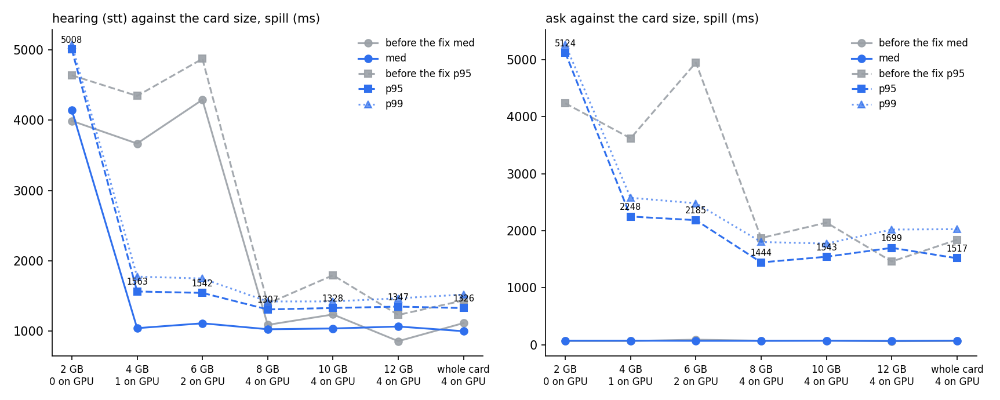
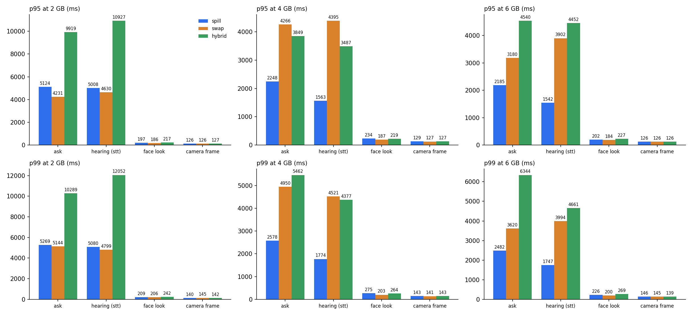

# GPU-memory planner on the real PC: card sizes 2 to 12 GB, before and after the placement fix (2026-11-26)

Everything here was **measured on the booth PC** (RTX 5070 Ti Laptop, 12227 MiB, CUDA torch) with the real Voice stopped for each run and started
again after (it answered with all four models on the GPU both times). Two full runs of `python tools\vram_measure.py all`:

* **Before:** the planner as merged in #269/#280 (run earlier on 2026-11-26).
* **After:** the same planner with the placement fix of PR #282 (`ffd537b3`: models that save the same time per MiB are ranked by the time they
  save, the planner waits for a busy model's idle moment instead of sending the newcomer to the CPU, and a check that a bigger card never puts fewer
  models on the GPU). Results folder `.local/perf/vram_2026-11-26_placement`, the earlier one `.local/perf/vram_2026-11-26`.

## 1. What was run

* A side Voice (port 8768) and side hub (8650) from the branch, with `MICE_VRAM_CAP_MIB` = 2, 4, 6, 8, 10, 12 GB and the whole card. The cap pretends a smaller
  card; **every program's real use counts as used**, so what the Voice can have is the cap minus what the others hold (face app and the Voice's own CUDA context:
  1423 MiB with no Voice running).
* Load, as at the booth: face `/api/look` 10 Hz, `/ask` and hearing `/transcribe` 0.5 Hz each, camera stream, plus 4 threads of background helper translations flat out.
  60 s per run, 2 runs per setting, the numbers are the mean of the 2 runs; 23 to 30 `/ask` and 14 to 30 hearing calls per run, so **p99 is close to the maximum and runs differ by 10 to 20%**.
* Strategies at 2, 4 and 6 GB: `spill` (the planner), `swap` (every model that fits alone takes a turn on the GPU, the others are unloaded and reload when used) and `hybrid` (as spill, but
  background helper jobs run on a second CPU copy of the local model while the GPU queue is busy). `swap` and `hybrid` are experiments behind `MICE_VRAM_STRATEGY`.
* Four models: Whisper small (576 MiB), Whisper Thai medium (1856 MiB, serves Thai visitors), Whisper medium (1792 MiB, English), local model Qwen2.5-0.5B (1093 MiB); sizes measured by the planner on this PC.
  No request failed in any of the runs (0 errors in all of them).

## 2. Spill by card size: before and after the fix

ms, mean of 2 runs. "GPU models" counts what the planner placed on the GPU (of 4), read from Voice `/health`.

| card | GPU models before / after | hearing p50 before -> after | hearing p95 | ask p95 | ask p99 | background jobs in 60 s |
|---|---|---|---|---|---|---|
| 2 GB | 0 / 0 | 3991 -> 4144 | 4640 -> 5007 | 4235 -> 5123 | 5507 -> 5269 | 14 -> 13 |
| 4 GB | 0 / 1 | 3668 -> **1040** | 4346 -> **1562** | 3621 -> **2248** | 4189 -> 2577 | 15 -> 50 |
| 6 GB | 1 / 2 | 4291 -> **1109** | 4874 -> **1542** | 4949 -> **2185** | 5166 -> 2481 | 14 -> 50 |
| 8 GB | 3 / 4 | 1087 -> 1025 | 1389 -> 1306 | 1871 -> 1443 | 2202 -> 1802 | 66 -> 84 |
| 10 GB | 3 / 4 | 1235 -> 1035 | 1793 -> 1327 | 2141 -> 1543 | 2796 -> 1774 | 44 -> 81 |
| 12 GB | 4 / 4 | 855 -> 1063 | 1228 -> 1347 | 1459 -> 1699 | 1732 -> 2020 | 90 -> 78 |
| whole card | 4 / 4 | 1113 -> 997 | 1435 -> 1326 | 1841 -> 1516 | 2221 -> 2027 | 64 -> 81 |

After the fix, what is on the GPU: 2 GB none; 4 GB Thai hearing model; 6 GB Thai hearing model and the English medium model; 8, 10, 12 GB and the whole card all four.
Camera frames stay at 95 ms p50 and under 130 ms p95, and face look p95 at 186 to 234 ms, at every size.

What changed, against what the earlier run found:

1. **6 GB, the Thai hearing model now goes on the GPU.** Hearing p50 4291 -> 1109 ms (3.9 times faster), ask p95 4949 -> 2185 ms. Before the fix 6 GB was no better than 2 GB.
2. **10 GB no longer has fewer GPU models than 8 GB** (4 and 4, was 3 and 4): the local model is on the GPU. The GPU model counts by size are now 0, 1, 2, 4, 4, 4, 4: never fewer on a bigger card.
3. **4 GB gets the Thai hearing model too** (the smaller models leave room for it): hearing p50 3668 -> 1040 ms, 3.5 times faster, and 50 background jobs against 15.
4. **2 GB is unchanged:** nothing fits next to the face app (room -153 MiB against 576 MiB for the smallest model), everything is on the CPU, hearing about 4 s. A card of that size shared with this face app gives the Voice no GPU.
5. **8 GB and up have the same placement (all four), so the differences between those rows (ask p95 1.4 to 1.7 s, hearing 1.0 to 1.1 s) are run-to-run noise** and "a bigger card is never worse" holds as far as these two runs can show. The 12 GB row is
   slightly worse than the earlier 12 GB row (855 -> 1063 ms hearing p50), also inside that noise.

The CPU-only sizes cost: hearing is about 4.1 s p50 on the CPU, 1.0 to 1.1 s with the Thai model on the GPU under this load (0.51 s alone, section 4).

## 3. Spill vs swap vs hybrid at 2, 4 and 6 GB, after the fix

| card | strategy | ask p50 / p95 / p99 | hearing p50 / p95 / p99 | face look p95 | background jobs in 60 s | on the GPU |
|---|---|---|---|---|---|---|
| 2 GB | spill | 71 / 5124 / 5269 | 4145 / 5008 / 5080 | 197 | 13 | none |
| 2 GB | swap | 75 / 4231 / 5144 | 3990 / 4630 / 4799 | 186 | 14 | none |
| 2 GB | hybrid | 92 / 9919 / 10289 | 8037 / 10927 / 12052 | 217 | 86 | none |
| 4 GB | spill | 70 / 2248 / 2578 | 1041 / 1563 / 1774 | 234 | 50 | Thai hearing model |
| 4 GB | swap | 93 / 4266 / 4950 | 3981 / 4395 / 4521 | 187 | 14 | small |
| 4 GB | hybrid | 94 / 3849 / 5462 | 1593 / 3487 / 4377 | 219 | 96 | Thai hearing model |
| 6 GB | spill | 68 / 2185 / 2482 | 1110 / 1542 / 1747 | 202 | 50 | Thai hearing, English medium |
| 6 GB | swap | 78 / 3180 / 3620 | 3666 / 3902 / 3994 | 184 | 16 | local model, English medium, small |
| 6 GB | hybrid | 90 / 4540 / 6344 | 1525 / 4452 / 4661 | 227 | 96 | Thai hearing, English medium |

* **Winner by live p95/p99: spill, clearly, at 4 and 6 GB** (ask p95 2.2 s against 3.2 to 4.3 s for swap and 3.8 to 4.5 s for hybrid; hearing p95 1.5 to 1.6 s against 3.9 to 4.4 s for swap and 3.5 to 4.5 s for hybrid). At 2 GB nothing fits, so spill and swap are equal and hybrid is worse.
* **Swap loses once the planner places well.** It puts the wrong models on the GPU for the visitors (small, local model, English medium; the Thai hearing model stays on the CPU), so hearing is 3.7 to 4.0 s against 1.0 to 1.1 s. A swap also costs a reload:
  5.9 s for the Thai hearing model and 5.1 s for the local model onto the GPU.
* **Hybrid keeps the Thai hearing model on the GPU, so it is no longer the 3 times slower of the earlier run, but it is still worse for live work at every size** (hearing p95 3.5 to 4.5 s against 1.5 s, ask p95 3.8 to 4.5 s against 2.2 s, p99 up to 6.3 s)
  and does about 2 times more background jobs (96 against 50). It only pays if background throughput matters more than hearing speed.
* Where spill still loses: nothing measured. The earlier two losses are fixed (section 2). Not measured: whether spill beats a hybrid that diverts only part of the background jobs.

## 4. Calibration alone (after-run numbers)

| job | GPU alone | CPU alone |
|---|---|---|
| hearing (Thai medium, 3 s clip) | 511 ms | 3319 ms |
| local model helper translation | 541 ms | 888 ms |
| `/ask` needing the local model | 2080 ms | 3474 ms |
| `/ask` from the saved answers | 41 ms | 39 ms |
| reload a model onto the GPU | 5925 ms (Thai hearing), 5095 ms (local model) | - |
| **Spark Thai speech with feeling, one line** | **3320 ms** (25.2 s to load, 3193 MiB of VRAM) | 10820 ms (11.2 s to load) |

Spark speech was **not measured before**; it is measured now (the stale-server fault of the earlier run is fixed in `tools/vram_measure.py`). The planner does not place Spark; its 3.2 GB is on top of the four models (about 5.4 GB), so a card with
less than about 9 GB of room for the Voice cannot hold all of them and Spark. `config/vram_bench.json` carries the measured times (hearing GPU 422 / CPU 2877 ms and local model GPU 466 / CPU 821 ms from the earlier run,
now with Spark GPU 3320 / CPU 10820 ms).

## 5. Simulator against the measurement

`tools/bench_vram.py` with the measured service times (and 1.4 GB for the other programs) said swap is 4 to 6 times worse at 4 and 6 GB and that hybrid is the best at 6 to 8 GB. The measurement says swap is 3.5 times worse in hearing at 4 and 6 GB but only because it puts the
wrong models on the GPU, and hybrid is worse than spill at every size. With the Spark times added it says the same thing more strongly at 6 GB (visit p50: spill 11.9 s, hybrid 7.6 s, swap 303 s). The simulator does not model CPU sharing between a model and the helper copies, nor the face app growing; use the measurements for the strategy choice.

## 6. Caveats

* Two runs of 60 s per setting on a shared machine; read the numbers as direction (differences under about 15% are noise).
* The face app grew under the 10 Hz look load during each session and the sizes ran in ascending order, so the sizes are not perfectly independent.
* 2 and 4 GB were measured as "card minus the real face app and the Voice's CUDA context", not as a card on its own.
* The earlier run's per-size tables are kept in `docs/experiments/experiment-records.md`.

## 7. Reproduce

    cd E:\work\vram_260
    python tools\vram_measure.py all --tag mine --resume      (about 60 minutes, PC QC lock held; the real Voice is stopped and started again)
    python tools\chart_vram.py .local\perf\vram_<date>_mine --before .local\perf\vram_<date> --out docs\img\perf_vram_sizes.png --out2 docs\img\perf_vram_strategies.png --md docs\img\perf_vram_tables.md

`--resume` keeps every setting that already has results and runs only the missing ones; `--tag` keeps a run in its own folder. `python tools\vram_measure.py reduced` leaves the real Voice running (a Voice budget instead of a card size).
