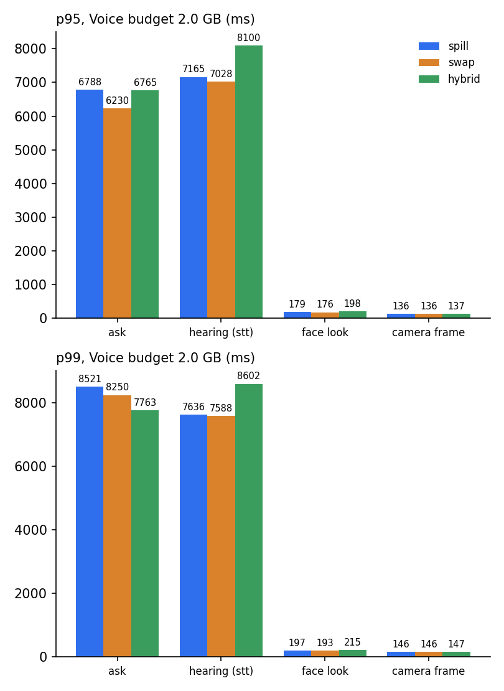

# GPU-memory planner on the real PC: spill, swap, hybrid (REDUCED run, 2026-11-26)

> **REDUCED.** The full 2, 4, 6, 8, 10 and 12 GB measurement needs the real Voice stopped, and that was not
> allowed (the PC permission check refused it twice). This report covers **one Voice budget, 2 GB**, measured on the
> real PC with the real Voice left running. **Not measured:** 4 to 12 GB, any model alone on the GPU, Spark speech on
> the GPU. The command that completes the whole run is at the end.

## What was asked

"If the card has 2, 4, 6, 8, 10 or 12 GB, do it dynamically, nothing slower than needed, every app works. And if the CPU
is used: is spilling to the CPU, or queueing everything through the GPU like the scheduler, better? Measure."

## What was measured

* Branch `claude/project-thread-q4yvte`, planner `tools/vramplan.py` with the review fixes (`17788d89`), plus three
  switches added for this test (default unchanged): `MICE_VRAM_STRATEGY` = `spill` (the planner as shipped), `swap`
  (every model that fits alone takes a turn on the GPU, the others are unloaded and reload when next used) or `hybrid`
  (as spill, but background helper jobs run on a second CPU copy of the local model while the GPU queue is busy), and
  `MICE_VRAM_VOICE_BUDGET_MIB` (what the Voice itself may use, whatever else is on the card).
* Why a budget and not `MICE_VRAM_CAP_MIB`: the cap counts every program's real use as used. With the real Voice
  holding about 9 GB of the 12.2 GB card, a "2 GB card" left the side Voice nothing. A budget says: this Voice may use
  2 GB, nobody else is on that card.
* Setup: side Voice (port 8768) and side hub (8650) from the branch; the real hub, face app and camera were loaded as at
  the booth; the real Voice kept running (it holds the rest of the card: 9060 MiB of 12227 MiB were used before the side
  Voice started). Load: face `/api/look` 10 Hz, voice `/ask` and hearing `/transcribe` at 0.5 Hz each (show rate), camera
  stream, plus 4 threads of background helper translations flat out. 60 s per run, 2 runs per setting, the PC QC lock held
  so no QC ran under the numbers. 20 `/ask` and 12 hearing calls per run: **p99 is close to the maximum, and runs differ**.
* Models the planner placed (identical in all three settings, read from Voice `/health` `vram` after the runs):
  Whisper small on the GPU; Whisper Thai medium (1.9 GB), Whisper medium (1.9 GB) and the local model (Qwen2.5-0.5B, 1.2 GB)
  on the CPU. A 2 GB budget minus a 384 MiB headroom leaves 1664 MiB: the best saving per MiB (small, 0.86 ms per MiB) takes
  it, and nothing else fits next to it.

## Results (mean of 2 runs, ms)

| budget | strategy | ask p50/p95/p99 | hearing p50/p95/p99 | face look p50/p95/p99 | camera p50/p95/p99 | background jobs in 60 s | on the GPU |
|---|---|---|---|---|---|---|---|
| 2.0 GB | spill | 137 / 6788 / 8521 | 4644 / 7165 / 7636 | 75 / 179 / 197 | 114 / 136 / 146 | 36 | stt:small |
| 2.0 GB | swap | 144 / 6230 / 8250 | 4571 / 7028 / 7588 | 74 / 176 / 193 | 114 / 136 / 146 | 36 | stt:small |
| 2.0 GB | hybrid | 88 / 6765 / 7763 | 7177 / 8100 / 8602 | 82 / 198 / 215 | 114 / 137 / 147 | 80 | stt:small |

Per run (ask p95 / hearing p50): spill 8623 / 4287 and 4953 / 5001; swap 7648 / 4174 and 4811 / 4969; hybrid 7747 / 7147 and 5783 / 7207.
Raw files: `.local/perf/vram_2026-11-26/<setting>/perf1.json`, `perf2.json`, `info.json` (not committed; the same numbers are in
`docs/experiments/experiment-records.md`).

## Which strategy wins (at 2 GB, measured)

* **Spill, the planner as shipped, wins on live latency, and swap equals it.** The difference between spill and swap
  (ask p95 6788 against 6230 ms) is smaller than the difference between two runs of the same setting (8623 against 4953 ms),
  so it is not a result. In this test swap **did not swap anything**: the placements and the model that sat on the GPU were the
  same as spill, so "queue everything through the GPU with model swapping" was not really exercised. Why the local model and
  Thai hearing model never took the GPU alone in swap mode was not found (the Voice also asks its own resource plan, which
  reads the real, crowded card, before it asks the planner). Treat swap as **not measured**, not as "equal".
* **Hybrid is clearly worse for hearing and clearly better for background work.** Hearing p50 7177 against 4644 ms
  (+55%), hearing p95 8100 against 7165 ms (+13%), face look p99 215 against 197 ms; ask p95 and p99 are equal or lower
  (p99 7763 against 8521 ms). Background jobs done in 60 s: 80 against 36 (2.2 times more), because they no longer queue behind live
  work at the gate. The cost shows where the live work also runs on the CPU: at 2 GB the Thai hearing model is on the CPU, so
  the extra CPU copies of the local model compete with it. Hybrid would pay when the hearing model is on the GPU and only the
  helper is on the CPU; that case needs a bigger budget and was **not measured**.
* Pick by p95 and p99 of the live work: **spill** (the default, no change needed). Use hybrid only if background throughput
  matters more than hearing speed, and not when hearing is on the CPU.

## Calibration of the simulator (`tools/bench_vram.py`): partly done

The reduced run measured, alone, on the CPU (the whole Voice on a 300 MiB budget):

| job | measured on the CPU alone |
|---|---|
| hearing (Thai medium, 3 s clip) | 2789 ms |
| local model helper translation | 786 ms |
| `/ask` that needs the local model | 3219 ms |
| `/ask` answered from the saved answers (no model) | 35 ms |
| Spark Thai speech with feeling, one line | 9450 ms (15.2 s to load the server) |

The "GPU alone" calibration at 2 GB was invalid: the Thai hearing model (1.9 GB) does not fit a 2 GB budget even alone, so the
run timed the CPU again (hearing 2837 ms, helper 846 ms, the same as the CPU numbers). Swap cost to the CPU (first call
after `/unload`: loading the model again from disk cache) was 7873 ms for the Thai hearing model and 5169 ms for the local
model; the matching VRAM steps from `nvidia-smi` were unreliable because the real Voice and the face app move the card's
memory at the same time. **`config/vram_bench.json` was not updated and `tools/bench_vram.py` was not rerun with measured
times**, because the GPU times and the GPU swap cost are missing. For comparison only, from another session on the same PC
(real Voice, CUDA torch, different load): hearing 445 ms and the helper translation 256 ms on the GPU.

## What this does and does not show

* Measured: at a 2 GB Voice budget on this PC, with the face app and camera running, hearing is slow (p50 about 4.6 s,
  p95 about 7 s) because the Thai hearing model is on the CPU; the planner's choice is the one that fits (Whisper small), and
  that placement was what `/health` reported in every setting. Face look and camera frames are not hurt (p95 under 200 ms).
* Not measured: whether the planner picks well at 4, 6, 8, 10 and 12 GB; the real swap cost to the GPU; hybrid with the
  hearing model on the GPU; Spark speech on the GPU; anything about a card that really is small (the face app would be on it too).
* The numbers are from 2 runs of 60 s on a shared machine. Use them as direction, not as precise values.

## To finish the whole task

With the user's go-ahead to stop the real Voice for about an hour (it is started again by the tool with the same command,
in a `finally` block, and the tool holds the PC QC lock for the whole session):

    cd E:\work\vram_260
    python tools\vram_measure.py all          (calibration, 2 to 12 GB and the whole card, spill / swap / hybrid at 2, 4, 6 GB)
    python tools\chart_vram.py .local\perf\vram_<date> --out docs\img\perf_vram.png --md docs\img\perf_vram_tables.md

`python tools\vram_measure.py smoke` is a 10-minute dry run first. This report's own run was
`python tools\vram_measure.py reduced` (the real Voice stays up; budgets of 2 and 2.5 GB are tried when the real card has
enough free memory, only 2 GB fitted).
